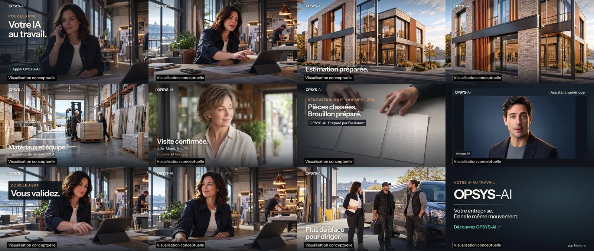
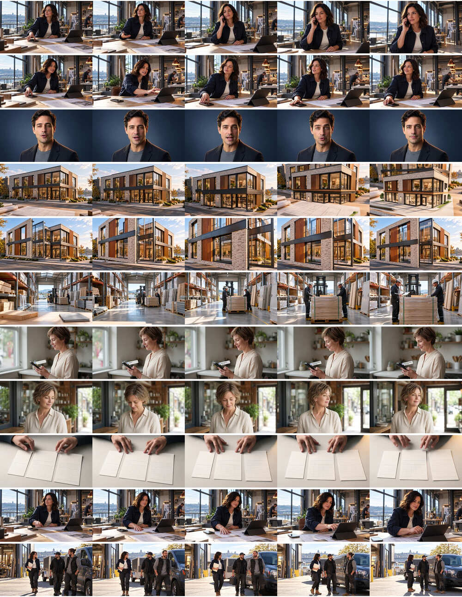
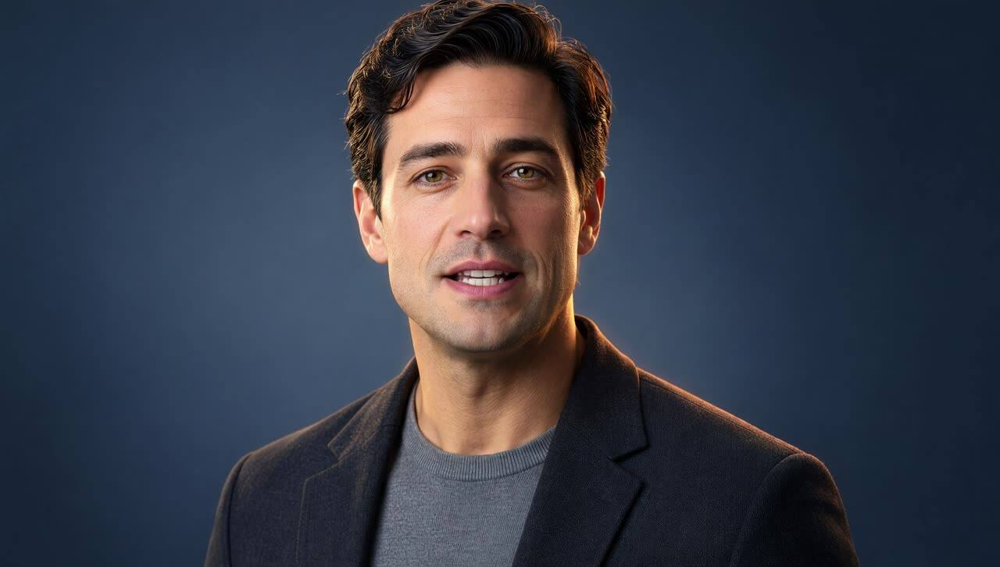
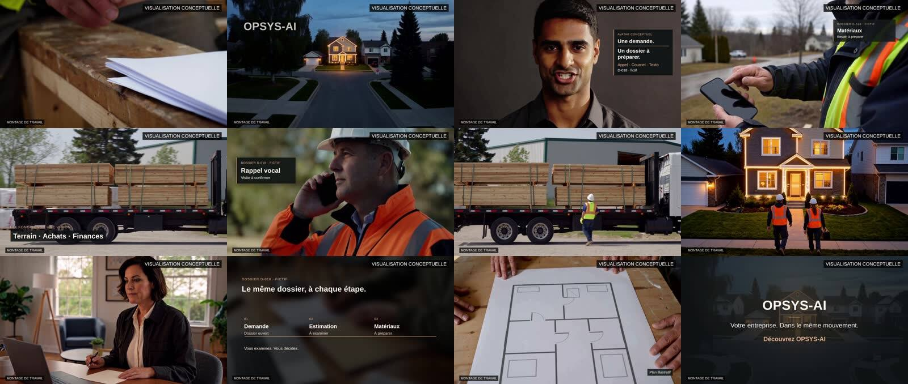
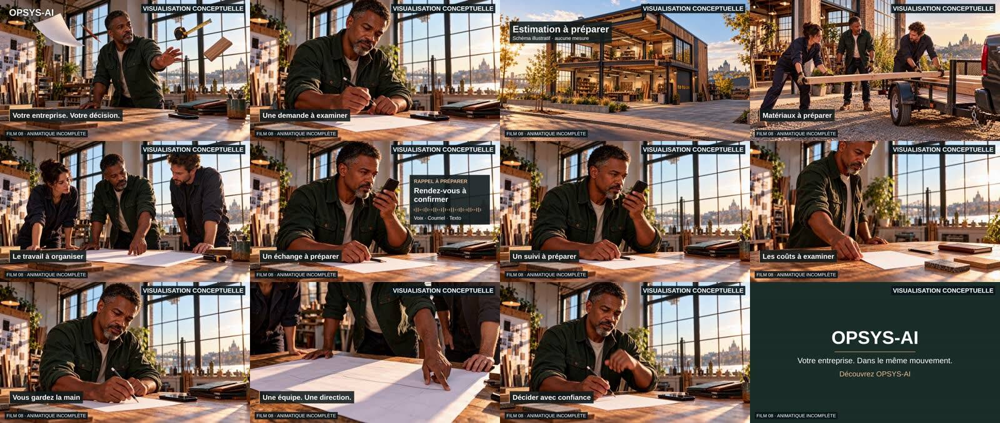
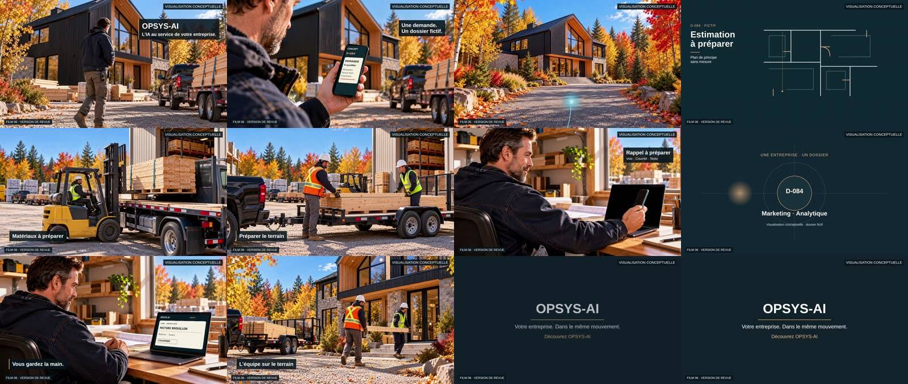
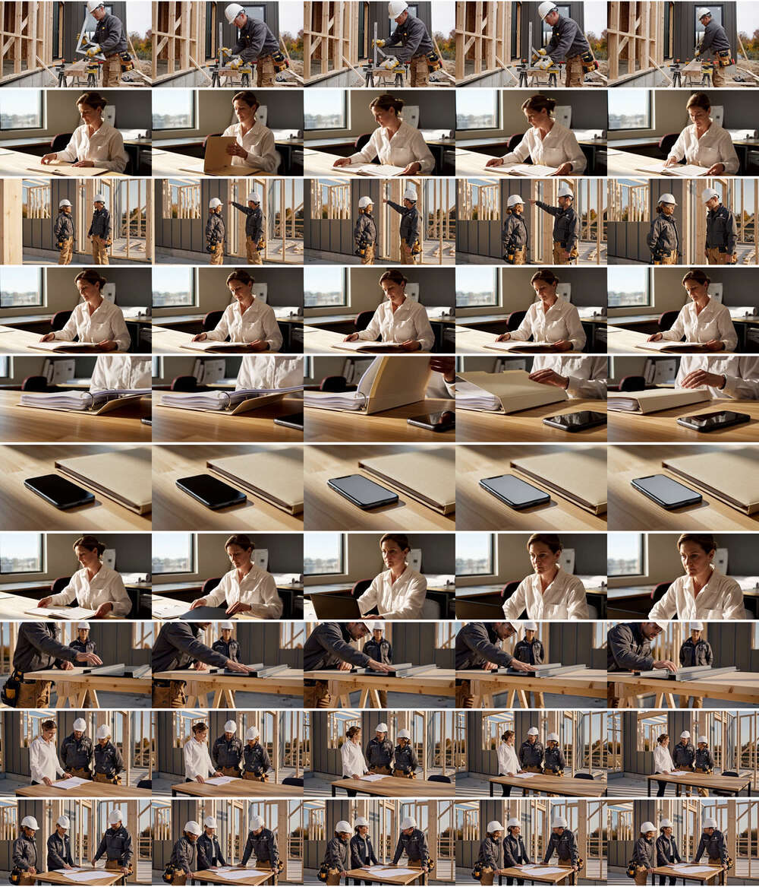
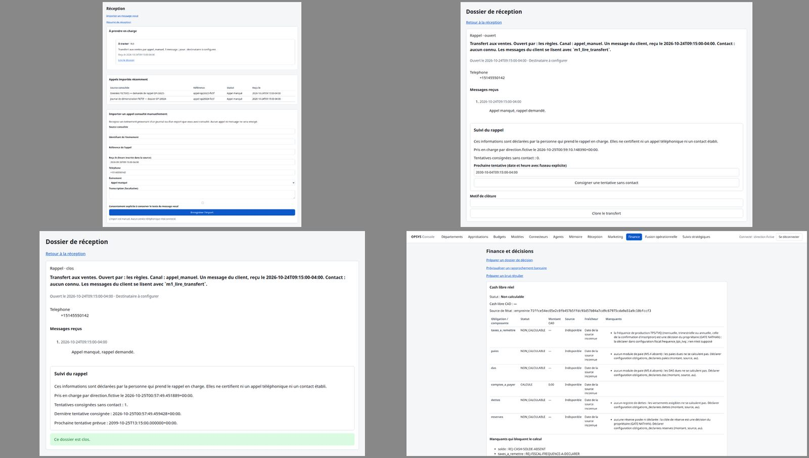
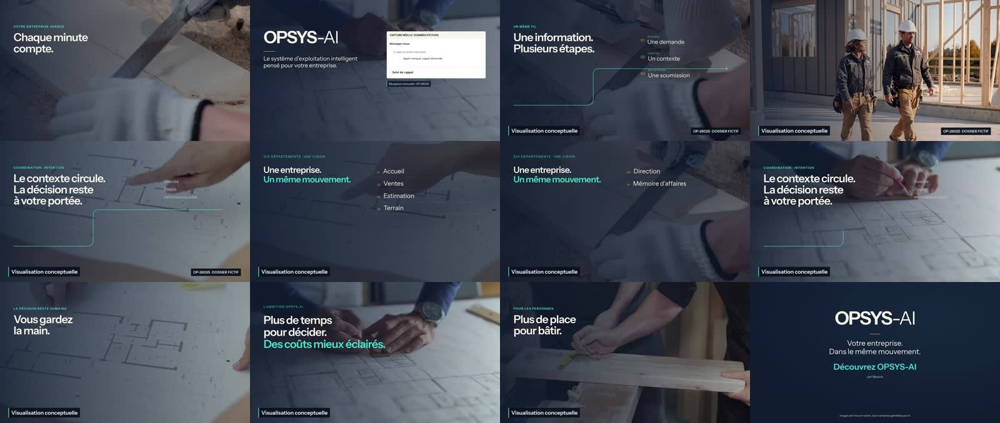

# Matière OPSYS-AI trouvée sur pc1 (audit du 03/11/2026)

Audit en lecture seule de pc1, sans rien supprimer ni déplacer. Copies utiles (environ 700 Mo) dans `~/nexora-creative-data/work/opsys-pc1/` sur pc6, avec `MANIFESTE.md` (chemin d'origine, taille, contenu, qualité, fabrication). Les vignettes de ce dossier sont dans `matiere-pc1/`.

## Résumé

Le fondateur a vraiment fait des vidéos OPSYS-AI sur pc1, et il y a de la matière : un projet Codex complet (`~/Documents/Codex/2026-10-24-prompt-codex-film-promotionnel-opsys-ai/OPSYS-AI/marketing/video-opsys-ai/`, 15 Go d'exports et 4 Go de médias), conçu en trois générations entre le 24 et le 31 octobre :

1. 24-25/10 : animatique puis films de revue (Veo 3.1, voix Adam).
2. 28/10 : film VFX (75 s) puis film Grok Imagine 1.5 de 45 s (prises avec dialogues natifs, avatar).
3. 29-31/10 : huit films MiniMax H3 en local (ComfyUI sur RTX 5090), voix Alexandre, plus de 200 essais de travail.

Plus de 360 fichiers vidéo de plus de 300 Ko modifiés dans les 14 derniers jours (la liste a été tronquée à 400 lignes) se trouvent dans ce projet et dans `NexoraStudioWork/minimax-h3/output`, dont une grande part d'essais de travail, de stock et de références de tiers ; hors travaux sans lien (WorkStudio, caches). Pour OPSYS : 5 films complets jugés utiles, 9 prises Grok brutes, 10 prises Veo, environ 80 plans H3 bruts, 3 enregistrements et 16 captures PNG de la vraie Console, 27 prises de voix, 4 musiques.

## Inventaire (ce qui compte)

| Élément | Durée / résolution | Audio | Ce que ça montre | Note |
|---|---|---|---|---|
| Film Grok 45 s (`video-opsys.mp4`, r2) | 45 s, 1080p, 24 i/s | oui | cheffe d'entreprise québécoise (skyline de Québec), appel, tablette, avatar, façade, entrepôt, équipe et camionnette ; textes « Visualisation conceptuelle » | 7,5 |
| 9 prises Grok brutes (G01-G09) | 4 à 15 s, 1920x1088 | oui (dialogue natif) | mêmes plans sans incrustation ; G03 = avatar parlant 15 s | 8 |
| Avatar H3 (`AVATAR-TRAVAIL-r14`) | 75 s, 1080p | oui (Alexandre) | avatar homme parlant synchronisé, chantier, camion, maison, plan | 6,5 |
| Films H3 06 et 08 | 75 s, 1080p | oui | chalet d'automne, entrepreneur à son atelier, très réalistes | 7 |
| Plans H3 bruts (film03, 04, 05, 08) | env. 5 s, 1344x768 | non | atelier hivernal, camionnette, moteur en coupe, maison en coupe, rappel, mains sur dossier, avatar sur téléphone ou tablette | 6 |
| Prises Veo 3.1 (3) et brand75 (7) | 6-8 s, 1080p et 1440p | non | bureau, chantier, dossiers, mains : plans propres de style publicitaire | 7 |
| Captures vraie Console (3 webm, 16 PNG) | 1-5 s, 1080p et 4K | non | Réception, Dossier, Suivi, Finance, Soumission du vrai produit, données fictives | 5 |
| Film VFX 75 s | 75 s, 1080p | oui | typographie, plans stock/IA, un extrait de capture Console, scènes Blender | 6 |
| Voix | 27 mp3 | | Alexandre Boutin (ElevenLabs v4, catalogue « French Canadian/Québec ») et Adam | à écouter |
| Musique | 4 mp3 | | 3 clips Lyria et 1 piste Pixabay | 6 |

Non copiés : scènes Blender (2,8 Go, 10 `.blend` : maison, réseau, noyau, dépôt, finance, croissance, mémoire), essais H3 de travail, et les publicités de tiers de `styles20261028/research-only/` (recherche seulement, jamais réutilisables).

## Les meilleurs éléments

### 1. Film Grok 45 s et prises brutes

Le meilleur matériau : personnages avec peau, cheveux, mains, décor québécois crédible, lumière cinéma. Rendu 1080p, 24 i/s. Fabriqué avec `x-ai/grok-imagine-video-1.5` (version 20260719) via OpenRouter et LiteLLM de pc1 ; musique `google/lyria-3-clip-preview` ; montage Remotion. Coût déclaré du lot : 20,41 USD. Les droits et la provenance sont dans `docs/DROITS-ET-PROVENANCE.md` (copie).

Les 9 prises brutes (ordre G01 à G09, plus G04 et G06 en prise 2) sont sans incrustation et avec piste audio native : on peut les remonter librement.

### 2. Avatar : il en existe deux, réalistes, avec peau et cheveux

Avatar Grok G03 : homme brun, costume sombre, fond bleu, 15 s qui parle en français. Peau texturée, cheveux individuels, éclairage studio. Ce n'est pas NVIDIA ACE ni Audio2Face : le document de droits (`DROITS-ET-PROVENANCE.md`) le dit expressément (« avatar synthétique original produit par Grok », aucun rendu ACE/A2F).

Avatar H3 (MiniMax H3 Ref2VA, ComfyUI local) : autre homme, parole synchronisée avec la voix Alexandre, utilisé aussi en tablette et sur téléphone dans les plans bruts (`F03-tablet-avatar-synchronise-r2`, `F05-phone-avatar-concept-r1`). Plus petit et moins stable que Grok (1344x768 en brut).

### 3. Films H3 réalistes

Plans réalistes (peau, barbe, bois, mélèzes d'automne) ; les habillages sont ceux d'une animatique (« Visualisation conceptuelle »), les plans bruts de `h3-plans/` en sont dépourvus. Licence MiniMax H3 Community (copie dans `docs/MINIMAX-H3-LICENSE.txt`, territoire limité : à relire avant diffusion commerciale).

### 4. Veo et brand75

Prises propres, gros plans (chantier, mains, cheffe de projet), 1080p et 1440p, sans audio. Veo 3.1 via OpenRouter.

### 5. Captures réelles de la vraie Console

Authentiques (Playwright sur le vrai produit, commit 54d89d3, données fictives) mais l'interface est sobre, presque brute : texte fin, fond gris pâle, aucun visuel spectaculaire. Utilisables en insert court (1 à 2 s) avec cadrage serré et recomposition graphique, pas en plan héros.

Le film VFX 75 s montre comment la capture Console a déjà été intégrée en insert (3e vignette).

## Voix : situation

- Il existe 11 prises de narration en voix `Alexandre Boutin - Professional` (ElevenLabs v4 ; description du catalogue : French Canadian/Québec) et une voix Adam, elle aussi décrite québécoise. Le modèle a généré ces voix par texte, avec prompt de direction ; aucune audition humaine n'est consignée dans le projet (« l'accent reste à valider à l'oreille »). Je ne les ai pas écoutées : l'accent est donc non vérifié.
- Les dialogues natifs des prises Grok sont générés par Grok (texte : « Opsis prépare le dossier et confirme à Julie… »). L'accent n'est pas attesté ; la prononciation de « OPSYS-AI » est approximative (« Opsis », « Opsis AI » selon le contrôle ASR du 31/10).
- Conséquence : la piste « voix québécoise » est la plus fragile. Il faut une audition courte avant de la réemployer.

## Recommandation pour une deuxième passe du film OPSYS-AI

Le film du jour (7,1/10) souffre de quatre faiblesses : pas de capture OPSYS, avatar en points lumineux, voix accentuée France, musique hors structure. Voici comment ce matériel y répond.

1. Avatar : remplacer l'avatar en points de lumière par G03 (Grok, 15 s) pour les plans 2 et 17 du concept (« Opsys, on en est où ? » et la réponse sur le camion). Il y a de la peau et des cheveux, le fond bleu marine va avec la charte. Garder le surtitre « VISION · EN DÉVELOPPEMENT » : ce n'est pas Audio2Face, et il ne faut pas le prétendre. Si l'on veut un avatar piloté par la voix du film, refaire un plan Grok ou H3 avec la nouvelle réplique, et ne pas mélanger deux visages.
2. Plans de vie et de département (4 à 15) : remplacer les plans génériques les plus faibles par G01 (appel), G05 (entrepôt), G09 (équipe et camionnette), G04 (façade en coupe, M3), G07/G08 (dossiers, mains, M1/M5) ; compléter par les Veo/brand75 (chantier, cheffe de projet) et les plans H3 bruts pour les départements restants (camionnette d'hiver, moteur en coupe, rappel). Les prises Grok ont de la peau, des mains et du décor québécois ; les H3 sont à 768p : les réserver aux insérts courts.
3. Authenticité produit : un insert de 1 à 2 s par département avec les captures de la Console (Réception, Dossier, Suivi, Finance), recomposées en gros plan sur un fond sombre, avec la mention « Capture réelle · données fictives ». C'est la seule preuve réelle ; elle ne peut pas porter un plan héros.
4. Voix : garder la narration en voix Alexandre ou en voix Québec (à écouter d'abord) ; si l'oreille rejette l'accent, relancer ElevenLabs v4 avec un texte fr-CA et une consigne explicite d'accent, puis écouter avant montage. Les dialogues Grok sont une option de secours (avec leurs prononciations de marque à corriger).
5. Musique : les 3 clips Lyria (`opening`, `pulse`, `tension`) peuvent servir de bases ; ils ne suivent pas la structure mesurée du concept, il faudra en régénérer ou les recaler sur les mesures.

Ce qui manque encore :
- vraie capture spectaculaire d'une Console qui tourne (la Console actuelle est sobre) : il faut soit un thème de présentation plus travaillé, soit un montage graphique fort autour de la vraie capture ;
- avatar réaliste piloté par une voix québécoise vérifiée (ni A2F ni MetaHuman ici ; les deux avatars existants sont des générations vidéo) ;
- voix québécoise écoutée et validée ;
- plans 4K : tout est en 1080p, 1344x768 pour les plans H3 bruts.

Licences et provenance (faits seulement) : Grok Imagine 1.5 (xAI, conditions API pro du 27/10), Veo 3.1 (Google via OpenRouter), MiniMax H3 (licence communautaire, territoire limité), voix ElevenLabs v4 via OpenRouter, musique Lyria et Pixabay. Les détails sont dans `docs/` du dossier de copies.
