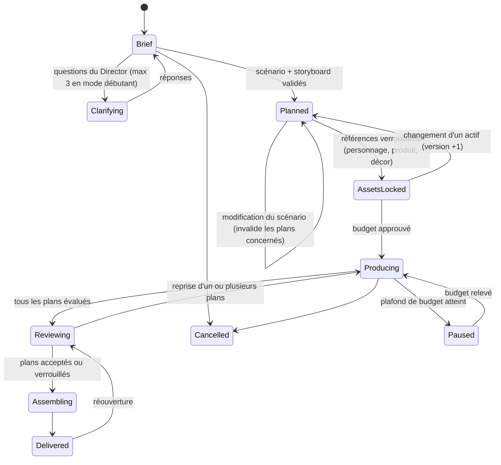
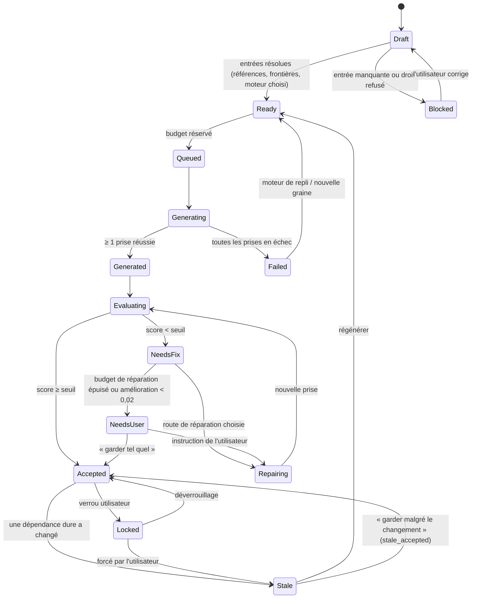
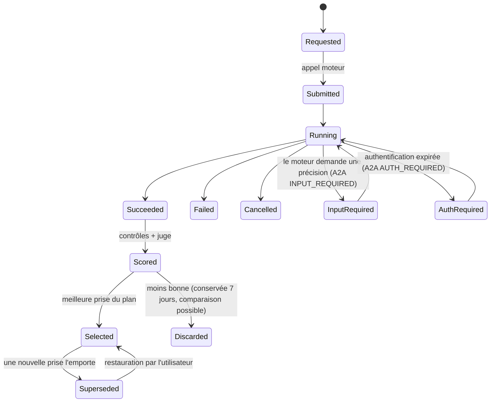

# 05 — Nexora AI Director et Registre universel de capacités

Rapport de recherche, rédigé le 30 octobre 2026. Lecture seule : aucun code tiers n'a été exécuté ni installé, aucun compte créé, aucune dépense engagée.

## 0. Légende, méthode et limites

Étiquettes de provenance, utilisées sur chaque affirmation non triviale :

| Étiquette | Sens |
|---|---|
| **[DOC]** | Lu dans une documentation officielle, une page produit ou une fiche de modèle (URL en section 12). |
| **[CODE]** | Constaté en lisant le code d'un dépôt cloné en `--depth 1` (chemin et commit en section 12). |
| **[PUBLIÉ]** | Affirmé par un article scientifique (identifiant arXiv ; seulement le résumé ou le texte récupéré a été lu, ce qui est précisé quand c'est plus que cela). |
| **[PROPOSÉ par moi]** | Ma conception, mon inférence ou ma recommandation. Non vérifiée par une source externe. |
| **[NON VÉRIFIÉ]** | Annoncé par la mission mais je n'ai pas pu le confirmer. |

Dépôts clonés (33, tous dans `/tmp/claude-1000/-home-pc6--claude-spares-spare-nqfgQg/4a161a25-a3c4-4a78-94f6-c7dc7ebef37d/scratchpad/director/<nom>/`) : MovieAgent, Anim-Director (contient AniMaker), FilmAgent (contient désormais VideoClaw), Mora, LLM-groundedVideoDiffusion, VideoAgent-HKUDS, ViMax, DramaAgent, comfyui-mcp-server-joenorton, ComfyUI, ComfyUI_frontend, comfy-cli, ComfyUI-LTXVideo, ComfyUI-WanVideoWrapper, comfyui-deploy, ViewComfy, cog, fal-docs (dépôt `fal-ai/fal`), fal-js, huggingface_hub, litellm, A2A, modelcontextprotocol, VACE, Phantom, FramePack, Self-Forcing, SkyReels-V2, LongLive, StoryDiffusion, VBench, IP-Adapter, LTX-Video.

Limites honnêtes de cette recherche :

1. Les crédits Firecrawl (search/scrape) et Exa ont été épuisés en cours de route. J'ai poursuivi avec WebFetch, alphaXiv, le connecteur Hugging Face et la lecture du code. Plusieurs pages produit n'ont donc été vues que par extrait de recherche ou par un résumé automatique de page.
2. Le Help Center de Runway a renvoyé HTTP 403 : ce que je dis de Runway repose sur des extraits de recherche et sur les fichiers de prix de LiteLLM, pas sur la doc officielle lue en entier.
3. Le dépôt VideoGen-of-Thought n'existe pas à l'URL que j'ai devinée (clone échoué) ; DirectorLLM, StoryAgent, CineCrew, MAViS, FRAMEWORKERS, CamPilot, MVAgent, FilmWorld et CineEvolve n'ont été lus que par résumé d'article, pas par code.
4. Aucune fonctionnalité « AI director » d'OpenAI n'a été trouvée : seules des entrées `sora-2`, `sora-2-pro` existent dans LiteLLM. Marqué **[NON VÉRIFIÉ]**.
5. Le code TypeScript/Zod de ce rapport n'a **pas** été compilé ni exécuté (interdit par la consigne). Il doit passer `tsc --strict` et des tests avant usage.
6. Les prix, versions et fonctionnalités cités datent de la lecture (30 oct. 2026) et bougent vite : le registre doit horodater chaque donnée (`pricedAt`, `reviewedAt`).

## 1. Synthèse : dix conclusions

1. **Le Director est une boucle plan → exécution → évaluation → réparation, pas un « gros prompt ».** Les systèmes qui se rapprochent d'un produit (ViMax, DramaAgent) sont tous des machines à états à artefacts persistés par plan, avec sélection best-of-N et réparation ciblée. [CODE] [PUBLIÉ]
2. **Best-of-N : N=2 par défaut.** L'article ViMax mesure que Best-of-2 est optimal (cohérence globale 0,5571, ~405 s, ~17,5 $ par tâche) et que N=3 ou 4 coûte plus et **dégrade** la cohérence (bruit de sélection du juge). [PUBLIÉ 2606.07649]
3. **Le juge VLM est un trieur, pas un arbitre.** Artifact-Bench : de nombreux MLLM sont proches du hasard sur la détection d'artefacts et mal alignés avec les humains ; un modèle de récompense spécialisé fait mieux. [PUBLIÉ 2605.18984, 2509.22646] Donc : métriques déterministes d'abord (visage ArcFace, objet DINO), VLM ensuite, humain en dernier recours.
4. **La reprise d'une scène existe déjà, mais de façon fragile.** ViMax saute les étapes dont le fichier existe (aucune invalidation par contenu) ; DramaAgent hache la requête de chaque prise et **lève une erreur** si le contexte a changé ; MovieAgent a un test d'existence mis en commentaire. Nexora doit faire mieux : empreinte de contenu + graphe de dépendances + états « périmé ». [CODE]
5. **L'édition in situ est la vraie réponse à « reprendre UNE scène ».** Fenêtre de retake de LTX Director (seul le segment sélectionné est régénéré, graine fixe pour garder la structure), inpainting vidéo masqué de VACE (MV2V), régénération d'un seul plan chez Flova. [DOC] [CODE]
6. **Le registre idéal combine quatre choses que personne ne combine encore** : le schéma d'entrée typé de Cog/fal (OpenAPI + extensions `x-`), l'expression de coût dépendant des paramètres de ComfyUI (`PriceBadge`, JSONata), la liste de modèles par modalité d'OpenRouter (durées, résolutions, SKU de prix) et les descripteurs sémantiques de FRAMEWORKERS (rôle, entrées, sorties, conditions de déclenchement). [CODE] [DOC] [PUBLIÉ 2608.29814]
7. **LiteLLM est le contre-exemple utile** : `model_info` est un sac plat de 255 clés distinctes pour 4 546 entrées, dont 85 de mode `video_generation` ; il n'exprime ni durée max, ni nombre de références, ni grille de trames. Tout ce qui est spécifique est rangé dans `provider_specific_entry`. À ne pas imiter, sauf pour ses champs de prix par résolution. [CODE]
8. **Les produits convergent vers le même vocabulaire de contrôle** : plans numérotés avec durée, cadrage, mouvement (Kling : « Shot 1 (2s): … ») ; références nommées `@personnage` ; presets de caméra, objectif, ouverture, éclairage (Higgsfield Cinema Studio 4.0) ; segments sur une timeline avec prompt global + prompts par segment (LTX Director). Le manifeste doit décrire ces *dialectes* de prompt, pas seulement des paramètres. [DOC]
9. **Les modèles de langage confondent translation et rotation de caméra, gauche et droite, mouvement d'objet et de caméra** (VLM non spécialisés). Donc le lexique caméra de Nexora doit fixer les conventions (repère écran, sens horaire vu de dessus) et la vérification de conformité caméra doit être un contrôle explicite. [PUBLIÉ 2607.03043, 2504.15376]
10. **Ce qui est « démo » vs « réel »** (détail en 2.1) : le code de recherche (MovieAgent, Mora, Anim-Director) est un enchaînement de modèles hétérogènes sans reprise ni gestion de coût ; ViMax v1.2.0 et DramaAgent sont les deux seules bases de lecture sérieuses pour l'orchestration.

---

## 2. Agents réalisateurs et vidéo multi-agents

### 2.1 Tableau d'évaluation « ce qui marche vs démo »

| Système | Ce que j'ai vérifié | Reprise / réparation | Verdict pour Nexora |
|---|---|---|---|
| **MovieAgent** (showlab, arXiv 2503.07314) | [CODE] dépôt de **inférence seule**, sans entraînement. Classe `ScriptBreakAgent` avec `ScriptBreak → ScenePlanning → ShotPlotCreate → VideoAudioGen → Final` ; modèles hétérogènes embarqués (ROICtrl, ConsisID, SVD, VC2, F5-TTS, OmniGen). Le premier prompt de `system_prompts.py` est un prompt d'évaluation d'images sans rapport avec le film (code de recherche non nettoyé). Dernier commit 2025-03-26. [PUBLIÉ] hiérarchie scénariste / directeur / storyboard / chef décorateur, chaîne de pensée. | **Aucune** : le test `os.path.exists(save_path)` est en commentaire (`run.py:293`). | Idée utile : la **hiérarchie de planification** (scène → plan → paramètres caméra). Ne pas intégrer le code. |
| **Anim-Director** (HITsz-TMG, 2408.09787) | [CODE] dossier `Anim-Director/code`. [PUBLIÉ] un grand modèle multimodal écrit l'histoire, le « script de réalisateur » (profils de personnages, décors), génère les images puis les prompts d'animation, **évalue la qualité et choisit le meilleur** de façon autonome. | Sélection du meilleur candidat ; pas de graphe de reprise. | Source du patron « génère, évalue, sélectionne ». |
| **AniMaker** (même dépôt, 2506.10540, SIGGRAPH Asia 2025) | [CODE] `Tools/eval.py` : classe `Evaluator` avec **AniEval** (continuité pré/post via flux optique RAFT, comptage SAM, CLIP, DreamSim, score d'action ; pondérations explicites : Action-Score 2,0, BLIP-BLEU 1,5, VQA esthétique 1,0, DreamSim 0,3…). **MCTS-Gen n'apparaît que dans les README** : `grep -ri mcts` ne trouve aucun code. `Pipeline/pipeline.py` = 216 lignes. | Évaluation multi-métriques réelle ; recherche MCTS non publiée dans le code. | **AniEval est la meilleure référence de pondération multi-métriques** ; ne pas compter sur MCTS-Gen. |
| **ViMax** (HKUDS, 2606.07649) | [CODE] v1.2.0 (commit fd4b72e, 2026-09-30). Pipelines `idea2video`, `script2video`, `novel2movie` ; **protocoles `ImageGenerator` / `VideoGenerator` à typage structurel** (n'importe quelle classe avec `generate_single_image/video(prompt, reference_image_paths, **kwargs)`) ; fournisseurs Google Nano Banana, Veo, Seedance, Seedream, OpenRouter ; Web UI avec projets nommés, « Agent Loop », points de contrôle de rendu ; sélecteur VLM `BestImageSelector` (cohérence personnage + spatiale + fidélité à la description) ; `ShotDescription` avec `variation_type` (large/medium/small), `ff_desc`/`lf_desc` (première et dernière image), `cam_idx`. [PUBLIÉ] graphe de dépendances visuelles par caméra (ordre topologique, branches indépendantes en parallèle), vidéos de transition comme ancrage spatial. | **Reprise par existence de fichier** (`first_frame.png`, `video.mp4`, `selection.json`…), ~25 tests `os.path.exists` dans `script2video_pipeline.py`. Pas d'empreinte de contenu : modifier un prompt n'invalide rien. | **Meilleure base de lecture.** Reprendre : protocoles, `variation_type`, graphe de caméras, best-of-2. Corriger : invalidation. |
| **DramaAgent** (AIGeeksGroup, 2610.00097, AACL-IJCNLP 2026) | [CODE] 780 lignes lisibles. `Assessment` à 4 dimensions fixes `identity / semantic / temporal / audio_visual` (poids 0,35 / 0,30 / 0,20 / 0,15), seuil 0,80, 3 candidats, 2 tours de réparation, amélioration minimale 0,02, politique `keep_best` ou `fail`. Chaque prise = dossier `r{round}_c{index}` avec `request.json` et `candidate.json` ; **empreinte de requête** (`request_fingerprint`) vérifiée au rechargement. Réparation par **routes** : la dimension la plus faible choisit la consigne de correction ajoutée au prompt. Tests unitaires sans appel de modèle. | **Oui, la plus avancée** : checkpoint par prise, réparation ciblée « un seul regénération par tour, pas un nouveau lot K ». Mais le contexte modifié lève `ValueError` au lieu de créer une nouvelle prise. | **Modèle direct du cycle prise / évaluation / réparation de Nexora.** |
| **FilmAgent** (HITsz-TMG, 2501.12909) | [PUBLIÉ] à l'origine : agents (réalisateur, scénariste, acteurs, chef opérateur) dans des espaces 3D virtuels, boucles de critique/révision, évaluation humaine 3,98/5. [CODE] le dépôt contient aujourd'hui **VideoClaw** (2026) : agent « employé » piloté depuis OpenClaw, trois modes de génération à choisir par étape (première image, première+dernière image, images de référence), modèle configurable par mode. | Intervention utilisateur à tout moment (annoncé). | Confirme que « mode de conditionnement » est un choix de premier ordre, à porter dans le manifeste. |
| **Mora** (lichao-sun, 2403.13248) | [CODE] `mora/agent`, `actions`, `model_bank`, `demo.py` ; dernier commit 2024-10-10. [PUBLIÉ] agents spécialisés pour t2v, i2v, extension, v2v, connexion de vidéos ; « comparable à Sora sur VBench » (qualité vidéo 0,800 contre 0,797). | Non constaté. | Concept daté (modèles de 2024). Retenir : tâches `extend` / `connect` / `edit` comme primitives. |
| **LVD / LLM-grounded Video Diffusion** (Berkeley, ICLR 2024) | [CODE] LLM → « Dynamic Scene Layouts » (boîtes englobantes légendées par image) → générateur piloté par les boîtes (ZeroScope/ModelScope), avec cache des mises en page. | n/a | Idée réutilisable : **mise en page spatio-temporelle par LLM** pour les moteurs récents acceptant boîtes ou trajectoires. **[PROPOSÉ]** |
| **DirectorLLM** (2412.14484) | [PUBLIÉ] un LLM Llama 3 produit des **poses humaines** comme signal de conditionnement ; module indépendant applicable à UNet et DiT. Dépôt non cloné. | n/a | Utile pour scènes d'action humaine ; hors périmètre v1. |
| **VideoGen-of-Thought** (2412.02259 / 2503.15138) | [PUBLIÉ] une phrase → descriptions de plans → cinq domaines (dynamique des personnages, continuité du décor, évolution des relations, mouvements de caméra, éclairage HDR) avec auto-validation ; jetons « portrait préservant l'identité » ; transitions latentes aux frontières. Revendique +20,4 % de cohérence faciale intra-plan. **Dépôt introuvable à l'URL testée.** | n/a | Les cinq domaines de spécification sont un bon gabarit de fiche de plan. |
| **StoryAgent** (2411.04925) | [PUBLIÉ] agents conception / storyboard / vidéo / coordination / évaluation ; I2V personnalisé « LoRA-BE ». Dépôt non cloné. | n/a | Confirme la séparation coordinateur / évaluateur. |
| **VideoAgent** (HKUDS) | [CODE] cadre de *compréhension, montage et refonte* de vidéos existantes (CosyVoice, fish-speech, ImageBind, VideoRAG…) ; pas un réalisateur de génération. | n/a | Utile pour l'étape de montage / analyse, pas pour la planification. |
| **Articles 2026 non lus en code** | [PUBLIÉ] CineAGI (2604.23579), Better Call CineCrew (2609.07720) avec **FilmDSL** (langage structuré directives de plan / assets / continuité / persona), MAViS (2508.08487, « Script Writing Guidelines » pour la compatibilité scénario / outils), Camera Artist (2604.09195), CamPilot (2609.10943, planification caméra par GRPO, benchmark CamEval), MVAgent (2609.30609, « construction de conditions typées »), FilmWorld (2607.19038), CineEvolve (2610.29590, Réalisateur + Critique dans une même politique), UniMAGE (2512.23222), **FRAMEWORKERS** (2608.29814, voir 4.1). | | Convergence sur : spécification structurée intermédiaire (FilmDSL), conditions typées par plan (MVAgent), registre de sous-agents par descripteurs (FRAMEWORKERS). |

### 2.2 Ce qui est réellement livré par les produits (30 oct. 2026)

| Produit | Fonctions « réalisateur » vérifiées | Ce que ça implique |
|---|---|---|
| **Higgsfield Cinema Studio 4.0** [DOC] | Plans multiples jusqu'à **30 s** et **50 références** (3.5 : 15 s / 9). Un panneau unique : genre (7 : General, Action, Epic, Drama, Comedy, Horror, Noir), époque (Auto, 60s, 80s, 90s, 2000s, 2020s), tempo (Auto, Chaotic, Dynamic, Calm, Single Shot), caméra (Modern, DV Camcorder, 35mm Film, 8mm Film), objectif (Clean Sharp, Anamorphic, Vintage Anamorphic, Warm Vintage, Halation Vintage), ouverture (f/1.4, f/4, f/11), éclairage (Silhouette, Practicals, Window, Overhead Fall, Contre-jour, Soft Cross + réglage manuel couleur / luminosité / diffusion / angle), roue d'émotions (8) appliquée par `@personnage`, 30+ mouvements (POV, Robot Arm, Pan Left, Helicopter Shot, Tracking, Pedestal Down…), 45–50+ palettes. Un « Personal Assistant » ajuste genre/style/caméra par conversation et **découpe un script en plans avec paramètres caméra pré-remplis**. | Le *mode débutant* de Nexora = un panneau de choix discrets + assistant. Ce sont des **enums de manifeste**. |
| **Kling VIDEO 3.0 / 3.0 Omni** [DOC, guide Kling du 6 fév. 2026] | Multi-plans natif jusqu'à **15 s** par génération, mode personnalisé : durée, cadrage, angle, narration, mouvement de caméra **par plan** ; format d'invite `Shot 1 (2s): …` ou horodaté `[00:00 - 00:02] Medium shot:` avec ligne `Audio:` ; références `@Element1` ; éléments (apparence + voix) ; référence vidéo de personnage (3–8 s). Sources secondaires : jusqu'à 6 coupes par génération (Morphic). | Preuve qu'un moteur peut accepter une *liste de plans* : champ `nativeMultiShot` du manifeste. |
| **Runway Gen-4.5** [DOC partiel ; Help Center inaccessible] | Extraits : chorégraphie de caméra détaillée dans une seule invite ; références pour monde cohérent. Prix indicatifs dans LiteLLM [CODE] : `gen4.5` 0,12 $/s, `aleph2` 0,28 $/s (v2v), plus `veo3.1`, `seedance2*`, `hailuo3` revendus. | Runway est aussi un *agrégateur* : un même moteur peut avoir plusieurs « routes » (fournisseurs). Le manifeste doit séparer **modèle** et **route d'exécution**. |
| **Flova** [DOC, page « AI film maker »] | Scénario → plan de scènes → storyboard **vérifié avant de dépenser des crédits** ; plans générés par groupes puis revus en séquence face aux références ; **un plan peut être régénéré ou remplacé sans jeter le reste** ; musique/voix/scènes sur une timeline ; coûts selon modèle, durée, résolution ; « l'usage commercial dépend du forfait et des droits sur les entrées » ; « la direction par références ne dispense pas de relecture ». | Valide le flux : storyboard peu cher → validation → rendu. Les droits sont une donnée de première classe. |
| **ComfyUI App Mode** [DOC + CODE] | Doc : n'importe quel workflow devient une interface (4 étapes : entrées, sorties, aperçu, vue par défaut) ; partage par lien **réservé à Comfy Cloud** ; « aucune API décrite ». Code frontend : `extra.linearMode` et `extra.linearData = { inputs: [[nodeId, widgetName, {height?}]…], outputs: [nodeId…] }` dans le JSON du workflow. | Preuve que « workflow → formulaire » se réduit à une liste (nœud, widget). Pour Nexora : même idée, mais **typée et contrainte** (voir 5 et 6). |
| **LTX Director 2.0** [DOC RunComfy] | Extension *tierce* (WhatDreamsCost / MDMZ), pas un produit Lightricks : timeline avec prompt global + prompts par segment, pistes audio, durée et fréquence d'images, **fenêtre de retake** (seul le segment est régénéré), extension par ajout de segments, étape 2 d'upscale spatial ×2 ; modèle LTX-2.3 22B distillé. [DOC HF] checkpoints `dev` (entraînable) et `distilled` (8 pas, CFG=1) ; largeur/hauteur multiples de 32, nombre d'images ≡ 1 mod 8 ; licence « ltx-2-community-license-agreement ». [DOC ComfyUI-LTXVideo] **32 Go+ de VRAM, 100 Go+ de disque**. | Cas d'école de contraintes matérielles et de grille de trames à mettre dans le manifeste. |
| **OpenAI** | **[NON VÉRIFIÉ]** — pas de fonction « director » trouvée. LiteLLM liste `sora-2`, `sora-2-pro`, `sora-2-pro-high-res` sans prix par seconde. | — |

### 2.3 MCP pour ComfyUI

[CODE] `comfyui-mcp-server` (joenorton, dernier commit 2026-02-17) : serveur MCP HTTP ; **les workflows sont paramétrés par des jetons `PARAM_*`** dans le JSON d'API (`PARAM_PROMPT` → `prompt: str` requis ; `PARAM_INT_STEPS` → `steps: int` optionnel ; `PARAM_FLOAT_CFG`…) ; modèle `WorkflowParameter{name, placeholder, annotation, description, bindings[(node, input)], required}` ; outils `generate_image`, `get_asset_metadata`, `regenerate` (itération sur un actif existant avec surcharge de paramètres). Limite constatée : **le registre d'actifs est en mémoire et se vide au redémarrage** (message d'erreur explicite dans `tools/asset.py`). Aucun typage de contraintes (min/max/enum) dérivé de `/object_info`.

[CODE] `comfyui-deploy` (BennyKok, dernier commit 2025-11-12) : des **nœuds « Deploy External »** (`ComfyUIDeployExternalImage`, `…Enum`, `…NumberInt`, `…Lora`, `…Checkpoint`…) marquent les entrées avec `input_id`, `display_name`, `description`, `options`, `default_value` : l'interface est dérivée du graphe. [CODE] `ViewComfy` : un `workflow_api.json` déposé dans un éditeur de formulaire produit un `view_comfy.json` décrivant les champs exposés.

Trois dialectes de « workflow → API » (jetons `PARAM_*`, nœuds marqueurs, JSON de formulaire) : aucun ne porte ni coût, ni licence, ni matériel, ni santé. C'est exactement la lacune que comble le manifeste.

---

## 3. Cohérence (personnages, produits, environnements), vidéo longue, évaluation, boucle de correction

### 3.1 Techniques de cohérence : ce que chacune garantit réellement

| Technique | Faits vérifiés | Quand l'utiliser dans Nexora | Limites |
|---|---|---|---|
| **Éléments / Omni références** (Kling 3.0 Omni, Higgsfield `@personnage`, jusqu'à 50 références) | [DOC] éléments réutilisables (apparence + voix) entre plans et générations ; références nommées dans l'invite. | Chemin par défaut du *mode débutant* quand le moteur choisi les supporte. | Propriétaire ; plafond de références, formats et règles propres à chaque moteur. Les très grands plans réduisent le sujet à quelques dizaines de pixels (guide invideo [DOC]). |
| **Wan-VACE** (`ali-vilab/VACE`) | [CODE] une seule architecture pour R2V (référence → vidéo), V2V (édition), **MV2V** (édition masquée) ; préprocesseurs `depth`, `flow`, `pose`, `scribble`, `inpainting` (bbox), `firstframe`, `frameref`, `clipref`… ; tailles ~81×480×832 (1,3B) et ~81×720×1280 (14B) ; licence **Apache-2.0** pour les poids Wan2.1-VACE (fiche HF [DOC]). | Édition locale d'un plan (remplacer un objet, masquer un défaut), contrôle structurel. | Résolution et durée courtes ; 14B lourd (VRAM non précisée dans le README lu). |
| **Phantom** (ByteDance) | [CODE][DOC] sujet-vers-vidéo à une ou plusieurs références, bâti sur Wan2.1 ; Phantom-Wan 1.3B (480P et 720P) et 14B ; Apache-2.0 (fiche HF). Adapté dans ComfyUI-WanVideoWrapper. | Identité multi-sujets (personnage + produit) en local. | Dépend de Wan2.1 (VAE, encodeur de texte) ; durée courte. |
| **Enchaînement première / dernière image** | [CODE] ViMax génère pour chaque plan `first_frame.png` et optionnellement `last_frame.png`, selon `variation_type` ; VideoClaw propose trois modes (première image, première+dernière, références). | Continuité d'un plan à l'autre et transformations (car → robot). | Dérive cumulative si on chaîne la dernière image ; le plan suivant hérite des défauts. |
| **Vidéo de transition comme ancrage spatial** | [PUBLIÉ 2606.07649] une vidéo de transition entre deux angles d'une même pièce sert de source cohérente pour extraire les vues. | Plans d'une même scène sous angles différents. | Coût d'un clip supplémentaire. |
| **Graphe de dépendances visuelles** | [PUBLIÉ] [CODE] ViMax : `camera_tree.json`, ordre topologique, branches indépendantes en parallèle. Ablation : sans dépendances inter-plans, perte de 8,7 % de cohérence globale ; version « série » moins bonne ; version complète la meilleure (0,5571 en 405 s contre 0,5085 en 310 s pour le tout-parallèle). | Planificateur d'exécution du Director. | Nécessite un bon extracteur de personnages/décors. |
| **IP-Adapter** | [CODE] dépôt `tencent-ailab/IP-Adapter`, dernier commit 2024-06-28, Apache-2.0. | Cohérence en **images** (SD1.5/SDXL) pour les images clés. | Ancien ; surpassé par les éditeurs d'images à références multiples. |
| **StoryDiffusion** (Consistent Self-Attention) | [CODE] Apache-2.0, dernier commit 2024-09-26 ; enfichable sur SD1.5/SDXL ; bandes dessinées et transitions vidéo. | Storyboards cohérents sans entraînement. | SD1.5/SDXL seulement. |
| **LoRA de personnage / produit** | [PUBLIÉ] StoryAgent : LoRA-BE ; LTX : « entraînement mouvement, style ou ressemblance en moins d'une heure dans bien des cas » (fiche LTX-2.3 [DOC]). | Produit ou mascotte récurrents (série). | Entraînement = droits sur les images d'entrée + consentement. **[PROPOSÉ]** : à lier aux garde-fous de confidentialité. |
| **Planche de personnage (character sheet)** | [CODE] ViMax `CharacterPortraitsGenerator` génère des portraits canoniques ; DramaAgent gèle une « banque canonique » partagée par génération, évaluation et réparation. | Étape 1 du Director avant tout plan vidéo. | La banque doit être **versionnée** (voir 8). |

### 3.2 Vidéo longue : extension autorégressive

| Modèle | Faits [CODE]/[DOC] | Pour le registre |
|---|---|---|
| **FramePack** (lllyasviel) | Prédiction « section d'images suivante » ; **6 Go de GPU minimum** pour 60 s à 30 fps (1800 images) avec le modèle 13B ; > 30 Go de téléchargement ; sensible au bruit et au matériel (résultats légèrement différents d'un GPU à l'autre) ; Apache-2.0. | `hardware.minVramGb = 6`, `determinism = "best_effort"`, tâche `extend`. |
| **Self-Forcing** | Entraînement qui simule l'inférence (KV cache) ; temps réel ; **≥ 24 Go** (4090, A100, H100 testés) ; Apache-2.0. | Tâche streaming ; latence faible. |
| **LongLive** (NVlabs) | v1.0 interactive (changement d'invite en direct, ICLR 2026) ; **LongLive 2.0** (13 mai 2026) multi-plans, NVFP4, 45,7 FPS sur GB200 (hors décodage VAE) ; compression du cache KV ; Apache-2.0. | Capacité `streamingPrompts`, `nativeMultiShot`. |
| **SkyReels-V2 DF** | Diffusion Forcing, « durée infinie », **extension vidéo** et **contrôle première/dernière image** (code publié en mai 2025) ; variantes 1,3B-540P, 5B, 14B-540P/720P ; licence **« Skywork Community License »** (HF : `license: other`), usage commercial **sous conditions**. | Exemple de `commercialUse: "conditional"`. |
| **LTX-2.3** | Générateur audio-vidéo conjoint ; checkpoints dev / distilled ; upscalers spatial ×1,5 / ×2 et temporel ×2 ; **ComfyUI** : nœuds `looping_sampler`, `iclora` (IC-LoRA), `guiders`, `hdr_*`. | Voir manifeste exemple A (5.3). |

Règle **[PROPOSÉ par moi]** : une durée demandée > `maxDurationS` du moteur retenu n'est pas une erreur mais un *signal de segmentation* : le planificateur crée des segments liés par `extend` (si disponible), sinon par chaînage dernière-image → première-image, en ajoutant un risque de dérive par jonction (voir 7).

### 3.3 Évaluation automatique

Quatre étages, du moins cher au plus subjectif **[PROPOSÉ par moi]**, avec les briques réelles :

1. **Contrôles techniques déterministes** (gratuits) : durée, fps, résolution demandées ; flux audio présent ; images noires / figées ; scintillement. VBench fournit `temporal_flickering`, `motion_smoothness`, `dynamic_degree`, `imaging_quality`, `aesthetic_quality`. [CODE] VBench : 16 dimensions de base (`subject_consistency`, `background_consistency`, `aesthetic_quality`, `imaging_quality`, `object_class`, `multiple_objects`, `color`, `spatial_relationship`, `scene`, `temporal_style`, `overall_consistency`, `human_action`, `temporal_flickering`, `motion_smoothness`, `dynamic_degree`, `appearance_style`).
2. **Identité par plongements** : `subject_consistency` de VBench utilise **DINO** (`dino_transform`, `torch.hub.load`) ; VBench-2.0 `human_identity` utilise **ArcFace + RetinaFace** (`third_party/arcface`, `retinaface`). [CODE] DynSC-Eval propose un suivi dynamique des sujets avec six métriques d'objet et détection d'événements d'incohérence. [PUBLIÉ 2610.01052] LongAV-Compass combine DINOv2, ArcFace, CLIP, ImageBind. [PUBLIÉ 2605.26244]
   Règle de choix **[PROPOSÉ]** : visage humain → ArcFace (cosinus contre chaque référence canonique) ; véhicule / produit / mascotte → DINOv2 sur recadrage détecté ; décor → CLIP + DINO global ; cohérence temporelle → flux optique (RAFT, comme AniEval).
3. **Juge VLM structuré** : grille fixe, sortie JSON. DramaAgent : `identity`, `semantic`, `temporal`, `audio_visual` en [0,1] (0 absent, 0,5 défauts majeurs, 0,8 défauts mineurs, 1 pleinement étayé), avec **`evidence` obligatoire qui nomme les limites** (« images échantillonnées, plan audio, pas d'écoute réelle ») et interdiction de prétendre à une synchronisation labiale non observée. [CODE] VQQA génère des **questions visuelles dynamiques** et utilise les critiques VLM comme « gradients sémantiques » pour optimiser l'invite en boucle fermée (+11,57 % T2V-CompBench, +8,43 % VBench2). [PUBLIÉ 2603.12310]
4. **Détecteurs d'artefacts spécialisés** : REACT (modèle de récompense image par image pour distorsions structurelles, 2601.04033), DeeptraceReward (annotations avec boîte englobante et horodatage de début/fin ; un modèle 7B fait +34,7 % par rapport à GPT-5 sur l'identification des traces, 2509.22646), Skyra et REVEAL pour la détection explicable (2512.15693, 2502.14994). [PUBLIÉ] Message : les juges généralistes sont **insuffisants** (Artifact-Bench 2605.18984) ; prévoir un « slot » `evaluator` dans le registre pour brancher ces modèles.
5. **Conformité caméra** : les VLM confondent translation / rotation, gauche / droite, mouvement caméra / objet. [PUBLIÉ 2607.03043] CameraBench propose une taxonomie de primitives conçue avec des chefs opérateurs ; SfM rate les primitives sémantiques (« follow »), les VLM ratent les primitives géométriques. [PUBLIÉ 2504.15376] **[PROPOSÉ]** : vérifier la caméra en combinant estimation de pose (SfM / modèle 3D) et question VLM *après* conversion de la consigne en primitives géométriques.

Pondération de départ **[PROPOSÉ par moi]**, inspirée de DramaAgent (0,35 / 0,30 / 0,20 / 0,15) et AniEval (Action 2,0 ≫ DreamSim 0,3) :

| Dimension | Poids par défaut | Source de mesure |
|---|---|---|
| Identité (visages, produits, véhicules) | 0,30 | ArcFace / DINOv2 vs banque canonique + VLM |
| Fidélité sémantique (action, décor, objets) | 0,25 | VLM structuré + CLIP |
| Continuité temporelle (avec plans voisins) | 0,15 | flux optique + DINO frontière + VLM |
| Conformité caméra | 0,10 | pose estimée + VLM |
| Artefacts / physique | 0,10 | détecteurs spécialisés |
| Audio-visuel | 0,05 (0 si muet) | métriques audio ; ne jamais le « simuler » |
| Technique | 0,05 | contrôles déterministes (bloquant si échec) |

Ces poids sont **à calibrer** sur un jeu d'étalonnage annoté par des humains avant toute décision automatique ; avant calibration, le Director *propose* et l'utilisateur *tranche*.

### 3.4 Boucle de correction

Routes de réparation, étendant le tableau `ROUTES` de DramaAgent [CODE] (identity / semantic / temporal / audio_visual) avec des routes **à changement de moteur ou de mode d'édition** **[PROPOSÉ]** :

| Diagnostic (dimension la plus faible) | Réparation 1 (peu coûteuse) | Réparation 2 | Escalade |
|---|---|---|---|
| Identité | Ajouter / améliorer références, répéter les traits immuables dans l'invite | Passer à un moteur à éléments/références (R2V) ou à Phantom / VACE R2V | Entraîner une LoRA (avec consentement) ou demander une meilleure photo |
| Sémantique | Réécrire l'invite avec l'élément manquant, réduire la complexité du plan | Scinder le plan en deux | Valider avec l'utilisateur |
| Temporel | Fixer l'image de frontière (dernière image du plan précédent) et ajouter la transition | Vidéo de transition (ViMax) | Changer le type de coupe |
| Caméra | Reformuler dans le dialecte du moteur (preset si disponible) | Moteur à trajectoire explicite | Caméra virtuelle en post (recadrage / mouvement sur une plaque haute résolution) |
| Artefacts localisés | Relancer la graine | **Retake de fenêtre** ou inpainting masqué (VACE MV2V, LTX retake) | Remplacer le plan |
| Technique | Recoder / reformater | Relancer | Marquer le moteur « dégradé » |

Budget **[PROPOSÉ]**, calé sur les valeurs publiées : `candidates = 2` (ViMax), `repairRounds ≤ 2`, `minImprovement = 0,02`, `threshold = 0,80`, politique `keep_best` avec drapeau « sous le seuil » (DramaAgent). Un plan encore sous le seuil après réparation passe en `needs_user` plutôt que de boucler.

---

## 4. Registre de capacités : ce que font les schémas réels

### 4.1 Comparaison

| Source | Ce qui est décrit | Mécanisme (vérifié) | Ce qui manque pour Nexora |
|---|---|---|---|
| **Cog / Replicate** | Entrées typées d'un prédicteur | [CODE] `Input(default, description, ge, le, min_length, max_length, regex, choices, deprecated, accept)` ; le générateur OpenAPI écrit `x-order` (ordre d'affichage), `x-cog-secret`, `x-cog-array-type: iterator`, `x-cog-array-display`, `x-cog-accept` ; [DOC] le schéma est dans `latest_version.openapi_schema` → `components.schemas.Input/Output` ; statuts `starting / processing / succeeded / failed / canceled`, `metrics.predict_time`. | Pas de niveaux simple / expert, pas de coût déclaré, pas de droits, pas de relations entre champs. |
| **fal.ai** | OpenAPI par point d'accès | [DOC] `queue.fal.run` : POST (soumission) → `GET …/requests/{id}/status` (IN_QUEUE / IN_PROGRESS / COMPLETED, `logs`, `queue_position`) → résultat → `PUT …/cancel`. Exemple Kling 2.1 Master i2v : `duration` enum `"5"\|"10"`, `cfg_scale` 0–1, `negative_prompt` ≤ 2500 car. ; extensions `x-fal-metadata`, `x-fal-order-properties`. [CODE] SDK fal : `VideoField(constraints=VideoValidationConfig(max_file_size, max_duration, max_area, min_duration), normalization=…(max_duration, fps))` émet un bloc **`x-fal`** et `ui.field = "video"` ; `x-fal-ui = {conflictGroups: [["forward","backward"]]}` (champs mutuellement exclusifs) ; **déclaration de facturation** `BillingComponents{version, schema_id, app: JSON-Schema des métriques}` publiée **hors OpenAPI** ; en-tête `x-fal-billable-units`. | Les contraintes média et les groupes de conflit existent mais ne sont pas normalisés entre modèles ; pas de licence. |
| **ComfyUI `object_info`** | Tous les nœuds installés | [CODE] `GET /object_info` : `input` (required / optional / hidden), `input_order`, `output`, `output_name`, `category`, `deprecated`, `experimental`, `api_node`, `search_aliases`, `essentials_category` ; V3 : `advanced` par entrée, `tooltip`, `lazy`, `min/max/step`, `display`, `control_after_generate`. L'API `/prompt` reçoit un graphe `{id: {class_type, inputs}}`. **`PriceBadge(expr, depends_on={widgets, inputs, input_groups}, engine="jsonata")`** : le prix est une *expression* qui lit les paramètres (exemple Kling : `$rates := $audio ? {"std":0.112,"pro":0.14,"4k":0.42} : {...}` ; `usd = rate × duration`). 47 fichiers `comfy_api_nodes/nodes_*.py` (Kling, Runway, Veo, Vidu, Wan, MiniMax, ByteDance, LTXV, Higgsfield, Luma, OpenAI, Gemini, ElevenLabs…) exposent les API cloud comme des nœuds. | Pas de droits, de santé, de matériel ; le schéma décrit un *nœud*, pas une *capacité* au sens produit. |
| **ComfyDeploy / ViewComfy / MCP-ComfyUI** | Workflow → API | voir 2.3. | Aucun ne porte contraintes inter-champs, coûts, droits. |
| **Hugging Face Inference Providers** | Mapping tâche × fournisseur | [CODE] `PROVIDER_T_TO_TASK_HELPER["fal-ai"]["image-to-video"] = FalAIImageToVideoTask()` ; chaque classe implémente `_prepare_payload_as_dict(inputs, parameters, provider_mapping_info)` et `get_response`. Exemple : l'entrée image devient `image_url`, les LoRA sont ajoutées en `loras: [{path, scale}]`. Tâches vidéo : `text-to-video`, `image-to-video` (fal-ai, novita, replicate, together, wavespeed). | Excellente séparation *interface standard* / *adaptateur par fournisseur* ; pas de coût ni de licence. C'est le patron de `binding`. |
| **LiteLLM `model_info`** | Prix et capacités de 4 546 modèles | [CODE] fichier JSON plat, **255 clés distinctes**, 85 entrées `mode: "video_generation"` : `output_cost_per_second`, `output_cost_per_second_480p/720p/1080p/4k/768p/2k`, `supported_modalities` (`["text","image","video","audio"]), `supported_output_modalities`, `supported_endpoints: ["/v1/videos"]`, `provider_specific_entry` (ex. `dashscope_video_reference_input: "first_frame"\|"reference_image"` ; `volcengine_video_frames` : table résolution × ratio → pixels ; `minimax_free_input_images`). | **Contre-exemple** : croissance par accrétion de clés ; aucune contrainte (durée max, nb de références, grille) ; seule une table de prix. À mimer : prix par résolution, modalités d'entrée. |
| **OpenRouter** | Modèles vidéo | [DOC] `GET /api/v1/videos/models` renvoie par modèle `supported_durations`, `supported_resolutions`, `supported_aspect_ratios`, `supported_sizes`, `pricing_skus`, `allowed_passthrough_parameters` ; soumission `POST /api/v1/videos` (202, `polling_url`), états `pending / in_progress / completed / failed`, coût réel `usage.cost` ; `frame_images` (première / dernière image) prime sur `input_references` (référence de contenu / style) ; `generate_audio` ; `seed` « non garanti par tous » ; une valeur non supportée renvoie un 400 qui liste les valeurs valides. | Bon socle de *découverte*, mais pas de niveaux, droits, santé. |
| **MCP** | Outil appelable | [CODE] schéma `draft` : `Tool{name, title, description, icons[], inputSchema (JSON Schema 2020-12, type=object), outputSchema, annotations{readOnlyHint, destructiveHint, idempotentHint, openWorldHint, title}, _meta}`. Les annotations sont des **indices non fiables** (« jamais de décision d'après un serveur non fiable »). | Bon format *de transport* d'un schéma ; `_meta` = point d'extension où loger le manifeste. |
| **A2A** | Agent distant | [CODE] `AgentCard{name, description, supported_interfaces, provider, version, capabilities{streaming, push_notifications, extensions[], extended_agent_card}, security_schemes, default_input_modes, default_output_modes, skills[], signatures[]}` ; `AgentSkill{id, name, description, tags[], examples[], input_modes[], output_modes[], security_requirements}` ; `TaskState` : SUBMITTED, WORKING, COMPLETED, FAILED, CANCELED, **INPUT_REQUIRED**, REJECTED, **AUTH_REQUIRED**. | Les états INPUT_REQUIRED et AUTH_REQUIRED sont à reprendre dans l'état d'une prise. Les skills sont *descriptives*, pas contraignantes. |
| **FRAMEWORKERS** | Sous-agents d'un directeur | [PUBLIÉ 2608.29814] chaque sous-agent a un descripteur : identifiant appelable, rôle sémantique, artefacts d'entrée requis, artefacts de sortie, conditions de déclenchement. Un Director Qwen3-8B affiné (SFT + GRPO) **gère de nouveaux sous-agents jamais vus en n'ayant que leur descripteur** : sélection correcte à 93,0 % (ComedyAgent) et 99,2 % (ScreenwriterAgent). | Valide « ajouter un modèle sans réentraîner ni changer l'interface » : tout le routage passe par des descripteurs. |

### 4.2 Leçons de conception **[PROPOSÉ par moi]**

1. **Un seul schéma, trois lecteurs** : (a) le générateur d'interface, (b) le planificateur du Director, (c) l'estimateur de coût / de droits. Si un champ n'est lu par aucun des trois, il n'a rien à faire dans le manifeste.
2. **Séparer sémantique canonique et paramètres propres au modèle.** Le Director ne raisonne que sur des clés canoniques (`duration`, `resolution`, `aspect_ratio`, `fps`, `seed`, `audio`, `camera`, `guidance`…) ; la correspondance vers le nom propre au moteur (`cfg_scale`, `PARAM_INT_STEPS`, nœud 57 / entrée `frames`) vit dans `binding`. C'est le patron HF `TaskProviderHelper`.
3. **Les contraintes inter-champs sont des données**, pas du code (« 1080p seulement si durée ≤ 8 s », « dernière image interdite avec référence vidéo », comme `x-fal-ui.conflictGroups`).
4. **Le coût est une expression des paramètres** (PriceBadge), avec table de tarifs **datée** et incertitude ; le coût réel constaté (`usage.cost` chez OpenRouter, `predict_time` chez Replicate) est ré-injecté pour recalibrer.
5. **Les droits sont une entrée bloquante, pas un texte d'aide** : `unknown` bloque l'usage commercial.
6. **Modèle ≠ route d'exécution.** Un même modèle (Seedance, Veo, Kling) est servi par plusieurs fournisseurs (LiteLLM : `fal_ai/…`, `volcengine/…`, `runwayml/seedance2`). Le manifeste décrit une *capacité exécutable* (modèle + route) ; une « famille de modèles » les regroupe.
7. **Versionner le contrat** (`contract: "nexora.capability/1"`) et le manifeste (SemVer) ; un moteur qui change de schéma doit déclencher une sonde de dérive (voir `health`).

---

## 5. Le manifeste `CapabilityManifest` (TypeScript + Zod, complet)

Fichier cible suggéré : `packages/capabilities/src/manifest.ts`. **[PROPOSÉ par moi] — non compilé, non exécuté.**

```ts
// manifest.ts — Nexora Creative — contrat "nexora.capability/1"
// Dépendance : zod ^3.23 (z.infer, z.lazy, discriminatedUnion, superRefine).
import { z } from "zod";

export const CONTRACT = "nexora.capability/1" as const;

/* ───────────────────────── Primitives ───────────────────────── */

const Slug = z.string().regex(/^[a-z][a-z0-9_]{0,47}$/);                 // clés de params / slots
const CapabilityId = z.string().regex(/^[a-z0-9][a-z0-9._-]*(\/[a-z0-9][a-z0-9._-]*){1,3}$/); // "kling/3.0-omni@fal"
const SemVer = z.string().regex(/^\d+\.\d+\.\d+(?:-[0-9A-Za-z.-]+)?$/);
const IsoDate = z.string().regex(/^\d{4}-\d{2}-\d{2}$/);
const Iso3166 = z.string().regex(/^[A-Z]{2}$/);
const Sha256 = z.string().regex(/^[a-f0-9]{64}$/);
const Duration8601 = z.string().regex(/^P(?:\d+D)?(?:T(?:\d+H)?(?:\d+M)?(?:\d+S)?)?$/); // "PT6H"
const Scalar = z.union([z.string(), z.number(), z.boolean()]);

/** Texte localisé : fr obligatoire, autres langues libres. */
export const I18n = z.object({ fr: z.string().min(1), en: z.string().optional() }).catchall(z.string());
export type I18n = z.infer<typeof I18n>;

export const Range = z.object({ min: z.number().optional(), max: z.number().optional() }).strict();

/* ───────────────────────── Vocabulaires ───────────────────────── */

export const Family = z.enum([
  "video", "image", "audio", "speech", "music", "llm", "vlm", "upscaler", "three_d", "evaluator", "utility",
]);

export const Task = z.enum([
  // vidéo
  "t2v", "i2v", "flf2v",            // texte→vidéo, image→vidéo, première+dernière image→vidéo
  "r2v",                            // références (personnage/produit/décor)→vidéo
  "v2v", "extend", "retake",        // édition globale, prolongation, régénération d'une fenêtre
  "motion_transfer", "replace",     // transfert de mouvement, remplacement de sujet/objet
  "inpaint_video", "outpaint_video", "lipsync", "multi_shot", "relight",
  "upscale_video", "interpolate",
  // image
  "t2i", "i2i", "image_edit", "character_sheet", "upscale_image",
  // audio
  "tts", "music", "sfx", "v2a", "stt",
  // texte / vision
  "plan_text", "caption", "judge", "embed_identity",
]);
export type Task = z.infer<typeof Task>;

export const MediaKind = z.enum([
  "text", "image", "video", "audio", "mask", "depth", "pose", "camera_path", "json", "element", "lora",
]);
export type MediaKind = z.infer<typeof MediaKind>;

export const SlotRole = z.enum([
  "prompt", "negative_prompt", "shot_list",
  "first_frame", "last_frame",
  "reference_character", "reference_product", "reference_environment", "reference_style", "reference_generic",
  "source_video", "driving_video", "mask", "depth", "pose", "camera_path",
  "audio_driver", "speech_text", "voice_reference", "lora", "element",
]);

/** Sémantique canonique : c'est ce que lisent le planificateur et l'estimateur de coût. */
export const Semantic = z.enum([
  "duration", "resolution", "aspect_ratio", "fps", "seed", "guidance", "steps", "audio_enabled",
  "motion_strength", "style_strength", "camera", "safety", "frame_count", "other",
]);
export type Semantic = z.infer<typeof Semantic>;

/* ───────────────────────── Conditions (DSL minimal, sérialisable) ───────────────────────── */
// ref : "param.<key>" | "slot.<key>.count" | "task" | "profile" | "mode".
export type Condition =
  | { all: Condition[] }
  | { any: Condition[] }
  | { not: Condition }
  | { ref: string; op: "eq" | "neq" | "gt" | "gte" | "lt" | "lte" | "in" | "present" | "absent"; value?: unknown };

export const Condition: z.ZodType<Condition> = z.lazy(() =>
  z.union([
    z.object({ all: z.array(Condition).min(1) }).strict(),
    z.object({ any: z.array(Condition).min(1) }).strict(),
    z.object({ not: Condition }).strict(),
    z.object({
      ref: z.string().min(1),
      op: z.enum(["eq", "neq", "gt", "gte", "lt", "lte", "in", "present", "absent"]),
      value: z.unknown().optional(),
    }).strict(),
  ]),
);

/* ───────────────────────── Entrées typées (slots) ───────────────────────── */

export const MediaConstraint = z.object({
  mime: z.array(z.string()).optional(),            // ["image/png","image/jpeg"]
  maxBytes: z.number().int().positive().optional(),
  durationS: Range.optional(),                     // pour audio/vidéo
  width: Range.optional(),
  height: Range.optional(),
  maxPixels: z.number().int().positive().optional(),
  aspect: Range.optional(),                        // largeur/hauteur
  fps: Range.optional(),
  multipleOf: z.number().int().positive().optional(),   // largeur/hauteur multiples de N
  minFacePx: z.number().int().positive().optional(),    // visage lisible requis (références d'identité)
}).strict();

export const InputSlot = z.object({
  key: Slug,
  kind: MediaKind,
  role: SlotRole,
  label: I18n,
  help: I18n.optional(),
  required: z.boolean().default(false),
  requiredIf: Condition.optional(),
  cardinality: z.object({ min: z.number().int().min(0).default(0), max: z.number().int().min(1) }).strict(),
  constraints: MediaConstraint.optional(),
  /** Comment ce moteur référence l'entrée dans l'invite : "@{name}", "[Image {n}]", positionnel… */
  referenceSyntax: z.object({ template: z.string(), positional: z.boolean().default(false) }).strict().optional(),
  tier: z.enum(["simple", "advanced", "expert"]).default("simple"),
}).strict();
export type InputSlot = z.infer<typeof InputSlot>;

/* ───────────────────────── Paramètres ───────────────────────── */

const ParamBase = z.object({
  key: Slug,
  label: I18n,
  help: I18n.optional(),
  semantic: Semantic.default("other"),
  /** simple = débutant ; advanced = replié ; expert = mode expert ; hidden = fixé par le profil. */
  tier: z.enum(["simple", "advanced", "expert", "hidden"]).default("advanced"),
  group: z.string().optional(),                    // regroupement visuel
  visibleIf: Condition.optional(),
  affectsCost: z.boolean().default(false),
  affectsQuality: z.boolean().default(false),
  deprecated: z.boolean().default(false),
});

export const ParamDef = z.discriminatedUnion("type", [
  ParamBase.extend({ type: z.literal("int"), default: z.number().int(), min: z.number().int().optional(),
    max: z.number().int().optional(), step: z.number().int().positive().optional(), unit: z.string().optional() }),
  ParamBase.extend({ type: z.literal("float"), default: z.number(), min: z.number().optional(),
    max: z.number().optional(), step: z.number().positive().optional(), unit: z.string().optional() }),
  ParamBase.extend({ type: z.literal("bool"), default: z.boolean() }),
  ParamBase.extend({ type: z.literal("string"), default: z.string().default(""),
    maxLength: z.number().int().optional(), pattern: z.string().optional(), multiline: z.boolean().default(false) }),
  ParamBase.extend({ type: z.literal("enum"), default: Scalar,
    options: z.array(z.object({ value: Scalar, label: I18n, help: I18n.optional(),
      availableIf: Condition.optional(), costHint: z.enum(["cheap", "normal", "expensive"]).optional() }).strict()).min(1) }),
  ParamBase.extend({ type: z.literal("seed"), default: z.number().int().nullable(),   // null = aléatoire
    guarantee: z.enum(["none", "best_effort", "strict"]).default("none") }),
  /** Durée : liste discrète (Kling "5"|"10") OU intervalle avec pas. */
  ParamBase.extend({ type: z.literal("duration"), default: z.number().positive(),
    allowed: z.array(z.number().positive()).optional(), range: Range.optional(), step: z.number().positive().optional(),
    asString: z.boolean().default(false) }),
  ParamBase.extend({ type: z.literal("resolution"), default: z.string() }),     // clé dans constraints.resolutions
  ParamBase.extend({ type: z.literal("aspect_ratio"), default: z.string(),
    allowed: z.array(z.string().regex(/^\d+:\d+$/)).min(1) }),
]);
export type ParamDef = z.infer<typeof ParamDef>;

/* ───────────────────────── Contraintes ───────────────────────── */

export const ResolutionOption = z.object({
  key: z.string(),                                   // "720p"
  label: I18n,
  sizes: z.record(z.string().regex(/^\d+:\d+$/), z.tuple([z.number().int(), z.number().int()])), // ratio → [w,h] (cf. LiteLLM volcengine_video_frames)
  fps: z.array(z.number().positive()).optional(),
  maxDurationS: z.number().positive().optional(),    // limite propre à cette résolution
  availableIf: Condition.optional(),
}).strict();

/** Grille de trames : LTX-2.3 = 8n+1 ; largeur/hauteur multiples de 32 (fiche HF). */
export const FrameGrid = z.object({
  mode: z.enum(["free", "n_plus_one"]),
  step: z.number().int().positive().default(1),      // 8 pour 8n+1
  offset: z.number().int().min(0).default(0),        // 1 pour 8n+1
  sizeMultipleOf: z.number().int().positive().optional(), // 32
}).strict();

export const Rule = z.object({
  id: Slug,
  when: Condition,
  then: z.enum(["forbid", "require"]),
  require: Condition.optional(),                      // si then="require" : condition à satisfaire
  severity: z.enum(["error", "warn"]).default("error"),
  message: I18n,
}).strict();

export const Constraints = z.object({
  resolutions: z.array(ResolutionOption).default([]),
  frameGrid: FrameGrid.optional(),
  durationS: Range.optional(),                       // plafond global (par plan unique)
  prompt: z.object({
    maxChars: z.number().int().positive().optional(),
    languages: z.array(z.string()).default(["en"]),
    preferredLanguage: z.string().default("en"),
  }).strict().default({ languages: ["en"], preferredLanguage: "en" }),
  limits: z.object({
    maxRefsTotal: z.number().int().min(0).optional(),    // ex. 50 (Higgsfield 4.0) ; 9 (3.5)
    maxInputBytesTotal: z.number().int().positive().optional(),
    maxConcurrent: z.number().int().positive().optional(),
    ratePerMin: z.number().int().positive().optional(),
  }).strict().default({}),
  rules: z.array(Rule).default([]),
}).strict();

/* ───────────────────────── Profils Rapide / Équilibré / Qualité ───────────────────────── */

export const ProfileId = z.enum(["fast", "balanced", "quality"]);
export type ProfileId = z.infer<typeof ProfileId>;

export const Profile = z.object({
  id: ProfileId,
  label: I18n,
  overrides: z.record(Slug, Scalar),                 // clé de param → valeur
  expect: z.object({
    latencyMultiplier: z.number().positive().default(1),
    costMultiplier: z.number().positive().default(1),
    qualityDelta: z.number().min(-1).max(1).default(0),   // vs "balanced"
  }).strict().default({}),
}).strict();

/* ───────────────────────── Sorties ───────────────────────── */

export const OutputSpec = z.object({
  key: Slug,
  kind: MediaKind,
  container: z.string().optional(),                  // "mp4", "png", "wav"
  includesAudio: z.boolean().default(false),
  maxDurationS: z.number().positive().optional(),
  watermark: z.enum(["none", "visible", "invisible", "c2pa"]).default("none"),
}).strict();

/* ───────────────────────── Tâches ───────────────────────── */

export const TaskSpec = z.object({
  task: Task,
  inputs: z.array(InputSlot).default([]),
  paramKeys: z.array(Slug).default([]),              // sous-ensemble de manifest.params
  outputs: z.array(OutputSpec).min(1),
  /** Remplace/complète les contraintes globales pour cette tâche. */
  constraints: Constraints.partial().optional(),
}).strict();

/* ───────────────────────── Coût ───────────────────────── */

export const RateRow = z.object({
  id: Slug,
  when: Condition.optional(),                        // première correspondance parmi les lignes de même "group"
  group: Slug.default("base"),
  unit: z.enum(["second_output", "frame_output", "image", "megapixel", "request", "second_input", "token_in", "token_out"]),
  usd: z.number().nonnegative(),
}).strict();

export const CostModel = z.object({
  kind: z.enum(["rate_table", "formula", "gpu_time", "free"]),
  rates: z.array(RateRow).default([]),
  /** Expression JSONata comme ComfyUI PriceBadge : résultat {"usd": nombre}. */
  formula: z.object({ engine: z.literal("jsonata"), expr: z.string().min(1), dependsOn: z.array(z.string()) }).strict().optional(),
  gpu: z.object({
    gpuClass: z.string(),                            // "H100-80G"
    usdPerHour: z.number().nonnegative(),
    secondsPerOutputSecond: z.record(z.string(), z.number().positive()),   // résolution → s de GPU par s de vidéo
    loadSeconds: z.number().nonnegative().default(0),                      // chargement à froid
  }).strict().optional(),
  minChargeUsd: z.number().nonnegative().default(0),
  expectedRetryFactor: z.number().min(1).default(1),
  uncertainty: z.object({ low: z.number().positive().default(0.85), high: z.number().positive().default(1.4) }).strict()
    .default({ low: 0.85, high: 1.4 }),
  pricedAt: IsoDate,
  source: z.string().url().optional(),
}).strict();

/* ───────────────────────── Licence et droits ───────────────────────── */

export const LicenseInfo = z.object({
  name: z.string(),                                  // "ltx-2-community-license-agreement"
  spdx: z.string().optional(),                       // "Apache-2.0"
  url: z.string().url().optional(),
  textSha256: Sha256.optional(),
  commercialUse: z.enum(["allowed", "conditional", "forbidden", "unknown"]),
  conditions: z.array(z.object({
    kind: z.enum(["revenue_cap", "attribution", "share_alike", "no_competing_model", "acceptable_use_policy",
      "registration", "plan_dependent", "other"]),
    detail: z.string(),
    threshold: z.object({ amount: z.number(), currency: z.string().length(3), period: z.enum(["year", "month", "total"]) }).strict().optional(),
  }).strict()).default([]),
  territories: z.object({ allow: z.array(Iso3166).optional(), deny: z.array(Iso3166).optional() }).strict().optional(),
  outputRights: z.enum(["user_owns", "shared", "provider_owns", "unclear"]),
  derivativesAllowed: z.enum(["yes", "conditional", "no", "n_a"]),       // LoRA, affinage
  weightsRedistribution: z.enum(["yes", "conditional", "no", "n_a"]),
  prohibitedUses: z.array(z.string()).default([]),
  likeness: z.enum(["no_real_persons", "consent_required", "unrestricted"]).default("consent_required"),
  review: z.object({
    status: z.enum(["verified", "pending", "unverified"]),
    reviewedAt: IsoDate.optional(),
    reviewedBy: z.string().optional(),
  }).strict(),
}).strict();

/* ───────────────────────── Matériel ───────────────────────── */

export const HardwareReq = z.object({
  runtime: z.enum(["cloud_api", "self_hosted_gpu", "comfy_cloud", "local_desktop"]),
  minVramGb: z.number().positive().optional(),       // FramePack 6 ; Self-Forcing 24 ; LTX-2 32
  recommendedVramGb: z.number().positive().optional(),
  minRamGb: z.number().positive().optional(),
  diskGb: z.number().positive().optional(),          // LTX-2 : 100
  gpuClasses: z.array(z.string()).default([]),
  quantizations: z.array(z.object({ name: z.string(), minVramGb: z.number().positive(),
    qualityDelta: z.number().min(-1).max(0) }).strict()).default([]),
  coldStartSeconds: z.number().nonnegative().optional(),
}).strict();

/* ───────────────────────── Confidentialité ───────────────────────── */

export const PrivacyGuards = z.object({
  locality: z.enum(["local", "eu", "us", "global"]),
  retention: z.enum(["none", "transient", "days_30", "indefinite", "unknown"]),
  trainsOnUserData: z.enum(["no", "opt_out", "yes", "unknown"]),
  processors: z.array(z.object({ name: z.string(), country: Iso3166 }).strict()).default([]),
  sendsMediaOffDevice: z.boolean(),
  acceptsBiometricInputs: z.boolean(),               // visages réels en entrée
  requiresConsentFor: z.array(z.enum(["real_person_likeness", "minor_present", "voice_clone", "third_party_ip"])).default([]),
  maxSensitivity: z.enum(["public", "internal", "confidential", "biometric"]),
  zeroRetentionAvailable: z.boolean().default(false),
  contentFilters: z.enum(["none", "provider_side", "nexora_side", "both"]).default("provider_side"),
}).strict();

/* ───────────────────────── Mapping vers l'exécution ───────────────────────── */

export const ParamBinding = z.object({
  /** "param.<key>" | "slot.<key>" | "const" */
  from: z.string().min(1),
  /** Pointeur JSON dans la requête, ou "<nodeId>.<inputName>" pour ComfyUI. */
  to: z.string().min(1),
  transform: z.enum([
    "identity", "to_string", "seconds_to_frames", "aspect_to_size", "asset_to_url", "asset_to_base64",
    "tag_references", "shotlist_to_prompt", "enum_map", "clamp", "random_seed_if_null",
  ]).default("identity"),
  map: z.record(z.string(), z.unknown()).optional(),     // pour enum_map
  const: z.unknown().optional(),
}).strict();

const OutputBinding = z.object({ path: z.string(), kind: MediaKind, key: Slug }).strict();

export const Binding = z.discriminatedUnion("kind", [
  z.object({
    kind: z.literal("comfy_workflow"),
    workflow: z.object({ id: z.string(), version: SemVer, apiJsonSha256: Sha256, path: z.string() }).strict(),
    bindings: z.array(ParamBinding).min(1),
    outputs: z.array(OutputBinding).min(1),            // path = id de nœud
    requiredNodes: z.array(z.object({ classType: z.string(), pack: z.string().optional(), minVersion: SemVer.optional() }).strict()).default([]),
    requiredModels: z.array(z.object({ folder: z.string(), file: z.string(), sha256: Sha256.optional(), bytes: z.number().int().optional() }).strict()).default([]),
  }).strict(),
  z.object({
    kind: z.literal("http_queue"),
    provider: z.string(),                              // "fal" | "replicate" | "runway" | "openrouter" | …
    endpoint: z.string(),
    openapiUrl: z.string().url().optional(),
    requestTemplate: z.record(z.string(), z.unknown()),    // valeurs "{{param.duration}}"
    bindings: z.array(ParamBinding).min(1),
    status: z.object({ statePath: z.string(), doneValues: z.array(z.string()), failedValues: z.array(z.string()),
      pollSeconds: z.number().positive().default(3) }).strict(),
    outputs: z.array(OutputBinding).min(1),
    secretRef: z.string(),                             // nom d'un secret, jamais la valeur
    webhook: z.boolean().default(false),
  }).strict(),
  z.object({
    kind: z.literal("mcp_tool"), server: z.string(), tool: z.string(),
    bindings: z.array(ParamBinding).min(1), outputs: z.array(OutputBinding).min(1),
  }).strict(),
  z.object({
    kind: z.literal("a2a_skill"), agentCardUrl: z.string().url(), skillId: z.string(),
    bindings: z.array(ParamBinding).min(1), outputs: z.array(OutputBinding).min(1),
  }).strict(),
]);
export type Binding = z.infer<typeof Binding>;

export const Execution = z.object({
  tasks: z.array(Task).min(1),
  binding: Binding,
  priority: z.number().int().default(0),               // route préférée = plus grand
}).strict();

/* ───────────────────────── Santé ───────────────────────── */

export const Probe = z.object({
  id: Slug,
  kind: z.enum(["schema_drift", "auth", "smoke", "latency", "golden"]),
  every: Duration8601,
  task: Task.optional(),
  fixture: z.object({ params: z.record(z.string(), z.unknown()).default({}), assets: z.array(z.string()).default([]) }).strict().optional(),
  assertions: z.array(z.object({
    metric: z.enum(["duration_s", "width", "height", "fps", "has_audio", "nonblack_ratio", "identity_score", "latency_ms", "http_status"]),
    op: z.enum(["eq", "gte", "lte"]), value: z.number(),
  }).strict()).default([]),
  budgetUsd: z.number().nonnegative().default(0),
  timeoutS: z.number().positive().default(600),
}).strict();

/** État d'exécution — NON stocké dans le manifeste, mais produit par le moniteur. */
export const RuntimeStatus = z.object({
  capabilityId: CapabilityId,
  state: z.enum(["healthy", "degraded", "down", "unknown"]),
  checkedAt: z.string(),                               // ISO datetime
  p50LatencyMs: z.number().optional(),
  successRate7d: z.number().min(0).max(1).optional(),
  schemaHash: Sha256.optional(),
  lastError: z.string().optional(),
}).strict();

/* ───────────────────────── Qualité a priori et conseils au Director ───────────────────────── */

export const QualityDimension = z.enum([
  "visual_fidelity", "motion", "prompt_adherence", "identity_hold", "camera_obedience",
  "physics", "text_rendering", "audio_sync", "long_take_stability", "multi_shot_coherence",
]);

export const QualityPriors = z.record(QualityDimension, z.object({
  score: z.number().min(0).max(1),
  n: z.number().int().min(0),                          // nombre d'évaluations derrière le score
  source: z.enum(["vendor_claim", "public_benchmark", "nexora_eval", "user_feedback"]),
  measuredAt: IsoDate,
}).strict());

export const CameraControl = z.object({
  mode: z.enum(["none", "prompt", "preset", "trajectory"]),
  dialect: z.string().optional(),                      // clé de traducteur (voir §11)
  presets: z.array(z.object({ id: z.string(), label: I18n }).strict()).default([]),
}).strict();

export const DirectorHints = z.object({
  promptDialect: z.enum(["free_text", "shot_list", "timecoded", "segments"]),
  nativeMultiShot: z.object({ maxShots: z.number().int().positive(), maxTotalS: z.number().positive() }).strict().optional(),
  continuity: z.array(z.enum(["first_frame", "last_frame", "extend_from_video", "element", "reference_images"])).default([]),
  editInPlace: z.array(z.enum(["retake_window", "mask_inpaint", "v2v_restyle", "none"])).default(["none"]),
  determinism: z.enum(["none", "best_effort", "strict"]).default("none"),
  camera: CameraControl,
  audio: z.enum(["none", "native", "separate_required"]).default("none"),
  strengths: z.array(z.string()).default([]),          // libellés libres pour l'explication ("plans larges", "visages")
  weaknesses: z.array(z.string()).default([]),
}).strict();

/* ───────────────────────── Cycle de vie ───────────────────────── */

export const Lifecycle = z.object({
  status: z.enum(["experimental", "beta", "stable", "deprecated", "retired"]),
  introducedAt: IsoDate.optional(),
  deprecatedAt: IsoDate.optional(),
  supersededBy: CapabilityId.optional(),
}).strict();

/* ───────────────────────── Le manifeste ───────────────────────── */

export const CapabilityManifest = z.object({
  contract: z.literal(CONTRACT),
  id: CapabilityId,                                    // "ltx/2.3-distilled@local", "kling/3.0-omni@fal"
  version: SemVer,                                     // version DU MANIFESTE
  family: Family,
  modelFamily: z.string(),                             // regroupe les routes d'un même modèle
  displayName: I18n,
  summary: I18n,
  vendor: z.object({ name: z.string(), url: z.string().url().optional(), modelId: z.string().optional(), modelVersion: z.string().optional() }).strict(),
  lifecycle: Lifecycle,
  tasks: z.array(TaskSpec).min(1),
  params: z.array(ParamDef).default([]),
  constraints: Constraints,
  profiles: z.array(Profile).default([]),
  cost: CostModel,
  license: LicenseInfo,
  hardware: HardwareReq,
  privacy: PrivacyGuards,
  execution: z.array(Execution).min(1),
  health: z.object({ probes: z.array(Probe).default([]) }).strict().default({ probes: [] }),
  quality: QualityPriors.default({}),
  director: DirectorHints,
  provenance: z.object({ sources: z.array(z.string().url()).default([]), authoredBy: z.string(), reviewedAt: IsoDate }).strict(),
}).strict().superRefine((m, ctx) => {
  const add = (path: (string | number)[], message: string) => ctx.addIssue({ code: z.ZodIssueCode.custom, path, message });

  const paramKeys = new Set(m.params.map(p => p.key));
  if (paramKeys.size !== m.params.length) add(["params"], "clés de paramètres en double");

  const resKeys = new Set(m.constraints.resolutions.map(r => r.key));
  m.tasks.forEach((t, i) => {
    t.paramKeys.forEach(k => { if (!paramKeys.has(k)) add(["tasks", i, "paramKeys"], `paramètre inconnu : ${k}`); });
    const slotKeys = t.inputs.map(s => s.key);
    if (new Set(slotKeys).size !== slotKeys.length) add(["tasks", i, "inputs"], "slots en double");
  });

  // Chaque tâche déclarée doit avoir au moins une route d'exécution.
  const executable = new Set(m.execution.flatMap(e => e.tasks));
  m.tasks.forEach((t, i) => { if (!executable.has(t.task)) add(["tasks", i], `aucune exécution pour la tâche ${t.task}`); });

  // Paramètres masqués : valeur par défaut obligatoire (ici toujours présente) et profils cohérents.
  m.profiles.forEach((p, i) => Object.keys(p.overrides).forEach(k => {
    if (!paramKeys.has(k)) add(["profiles", i, "overrides"], `paramètre inconnu : ${k}`);
  }));

  // Résolution : la valeur par défaut doit exister.
  m.params.forEach((p, i) => {
    if (p.type === "resolution" && !resKeys.has(p.default)) add(["params", i, "default"], `résolution inconnue : ${p.default}`);
    if (p.type === "enum" && !p.options.some(o => o.value === p.default)) add(["params", i, "default"], "défaut hors options");
    if (p.type === "duration" && p.allowed && !p.allowed.includes(p.default)) add(["params", i, "default"], "durée par défaut hors liste");
  });

  // Les liaisons doivent référencer des params/slots existants.
  m.execution.forEach((e, i) => {
    const slots = new Set(m.tasks.flatMap(t => t.inputs.map(s => s.key)));
    e.binding.bindings.forEach((b, j) => {
      if (b.from.startsWith("param.") && !paramKeys.has(b.from.slice(6))) add(["execution", i, "binding", "bindings", j], `param inconnu : ${b.from}`);
      if (b.from.startsWith("slot.") && !slots.has(b.from.slice(5))) add(["execution", i, "binding", "bindings", j], `slot inconnu : ${b.from}`);
    });
  });

  // Garde-fous d'honnêteté : commercial "allowed" exige une revue vérifiée ; sans revue → "unknown".
  if (m.license.commercialUse === "allowed" && m.license.review.status !== "verified")
    add(["license", "commercialUse"], "usage commercial 'allowed' interdit sans revue 'verified'");
  if (m.privacy.sendsMediaOffDevice && m.privacy.locality === "local")
    add(["privacy"], "locality=local incompatible avec sendsMediaOffDevice=true");
});

export type CapabilityManifest = z.infer<typeof CapabilityManifest>;
```

Notes d'implémentation : avec Zod 3, `z.record(QualityDimension, …)` produit un enregistrement partiel (ce qu'on veut) ; avec Zod 4 il devient exhaustif et il faut utiliser `z.partialRecord`. Les `.default({...})` sur objets imbriqués sont à retester selon la version.

### 5.1 Schéma JSON publié

`z.toJSONSchema` (Zod 4) ou `zod-to-json-schema` (Zod 3) génère le JSON Schema 2020-12 du manifeste. Il est publié comme `$id: https://nexora.example/schemas/capability/1.json` **[PROPOSÉ]**. Chaque manifeste peut être transporté :

* par **MCP** : dans `Tool._meta["nexora/capability"]` d'un outil `generate_*` (avec `inputSchema` dérivé du manifeste) ;
* par **A2A** : comme `AgentExtension{uri: "nexora/capability/1", params: <manifeste>}` d'une `AgentCard` ;
* par **OpenAPI** : en `x-nexora-capability` à côté de `x-fal-*`/`x-order` si le fournisseur sert déjà un OpenAPI.

### 5.2 Ce qui est volontairement hors du manifeste

* **Le prix de vente en crédits** : `crédits = ceil(usd × marge_plateforme / usd_par_crédit)` est une politique de la plateforme, pas du moteur.
* **Les secrets** : seulement `secretRef`.
* **L'état de santé courant** : `RuntimeStatus`, produit par le moniteur à partir des `probes`.
* **Les poids de qualité appris** : dérivés des prises réelles (Elo par tâche), stockés à part et recopiés dans `quality` avec `source: "nexora_eval"` à la publication.

### 5.3 Deux manifestes d'exemple (abrégés)

**A. `ltx/2.3-distilled@local` — workflow ComfyUI local.** Chaque valeur issue d'une source est annotée ; les champs marqués « à compléter » ou « à mesurer » ne sont pas vérifiés.

```jsonc
{
  "contract": "nexora.capability/1",
  "id": "ltx/2.3-distilled@local", "version": "0.1.0", "family": "video", "modelFamily": "ltx-2.3",
  "displayName": {"fr": "LTX-2.3 distillé (local)"},
  "summary": {"fr": "Audio+vidéo conjoints, 8 pas, rapide ; matériel exigeant."},
  "vendor": {"name": "Lightricks", "modelId": "ltx-2.3-22b-distilled-1.1"},          // [DOC] fiche HF
  "lifecycle": {"status": "stable"},
  "tasks": [
    {"task": "t2v",  "inputs": [{"key":"prompt","kind":"text","role":"prompt","label":{"fr":"Description"},"required":true,"cardinality":{"min":1,"max":1}}],
     "paramKeys": ["duration","resolution","fps","seed","audio"], "outputs": [{"key":"video","kind":"video","includesAudio":true}]},
    {"task": "flf2v", "inputs": [/* first_frame, last_frame */], "paramKeys": ["duration","resolution","fps","seed"], "outputs": [{"key":"video","kind":"video"}]}
  ],
  "constraints": {
    "frameGrid": {"mode":"n_plus_one","step":8,"offset":1,"sizeMultipleOf":32},       // [DOC] « divisibles par 32 ; images = 8n+1 »
    "resolutions": [/* à compléter depuis les workflows */]
  },
  "profiles": [{"id":"fast","label":{"fr":"Rapide"},"overrides":{"steps":8}}],        // [DOC] distillé : 8 pas, CFG=1
  "cost": {"kind":"gpu_time","gpu":{"gpuClass":"à mesurer","usdPerHour":0,"secondsPerOutputSecond":{"720p":0}},"pricedAt":"2026-10-30"},  // à mesurer
  "license": {"name":"ltx-2-community-license-agreement","url":"https://github.com/Lightricks/LTX-2/blob/main/LICENSE-2",
              "commercialUse":"unknown","outputRights":"unclear","derivativesAllowed":"conditional","weightsRedistribution":"conditional",
              "review":{"status":"unverified"}},                                      // texte non lu : bloque l'usage commercial
  "hardware": {"runtime":"local_desktop","minVramGb":32,"diskGb":100},                // [DOC] README ComfyUI-LTXVideo
  "privacy": {"locality":"local","retention":"none","trainsOnUserData":"no","sendsMediaOffDevice":false,"acceptsBiometricInputs":true,"maxSensitivity":"biometric"},
  "director": {"promptDialect":"segments","continuity":["first_frame","last_frame"],"editInPlace":["retake_window"],"camera":{"mode":"prompt"},"audio":"native","determinism":"best_effort"}
}
```

**B. `kling/3.0-omni@cloud` — API cloud.**

```jsonc
{
  "id": "kling/3.0-omni@cloud", "family": "video", "modelFamily": "kling-3",
  "tasks": [
    {"task":"multi_shot","inputs":[{"key":"elements","kind":"element","role":"element","cardinality":{"min":0,"max":4},
        "referenceSyntax":{"template":"@{name}"}}],"paramKeys":["duration","resolution","audio"]},
    {"task":"r2v"}, {"task":"i2v"}, {"task":"t2v"}
  ],
  "director": {"promptDialect":"shot_list",                                            // [DOC] « Shot 1 (2s): … »
               "nativeMultiShot":{"maxShots":6,"maxTotalS":15},                         // 15 s [DOC Kling] ; 6 coupes [source secondaire]
               "continuity":["element","first_frame"],"audio":"native","camera":{"mode":"prompt"}},
  "cost": {"kind":"formula","formula":{"engine":"jsonata","dependsOn":["duration","resolution","audio"],
           "expr":"{\"usd\": $lookup({\"std\":0.084,\"pro\":0.112,\"4k\":0.42}, $mode) * widgets.duration}"},   // forme tirée de ComfyUI nodes_kling.py ; tarifs à re-vérifier
           "pricedAt":"2026-10-30"},
  "license": {"name":"Conditions du fournisseur","commercialUse":"unknown","outputRights":"unclear","review":{"status":"unverified"}},
  "privacy": {"locality":"global","retention":"unknown","trainsOnUserData":"unknown","sendsMediaOffDevice":true,"acceptsBiometricInputs":true,
              "requiresConsentFor":["real_person_likeness"],"maxSensitivity":"internal"}
}
```

Règle pratique : **tout champ inconnu est explicitement `unknown`/`unverified`**, et le planificateur traite `unknown` comme bloquant pour l'usage commercial et pour les données `confidential` ou `biometric`.

---

## 6. L'interface se génère depuis le manifeste

Principe **[PROPOSÉ par moi]** : l'UI ne connaît aucun modèle. Elle connaît un petit nombre de *widgets* et une fonction pure `buildForm(manifest, task, ctx) → FormModel`. Ajouter un moteur = ajouter un fichier manifeste + un binding ; zéro ligne d'UI, sauf si une *nouvelle sémantique* apparaît (alors on ajoute un widget, une fois pour tous).

### 6.1 Table de dérivation

| Élément du manifeste | Widget (mode débutant) | Widget (mode expert) |
|---|---|---|
| `InputSlot kind=text role=prompt` | Zone de texte + assistant Director (« reformuler ») | idem + compteur de caractères (`constraints.prompt.maxChars`) et langue préférée |
| `InputSlot kind=image role=first_frame/last_frame` | Case « image de départ / d'arrivée » avec dépôt | idem + vérifications de `MediaConstraint` (formats, taille, ratio) |
| `InputSlot role=reference_*` avec `cardinality.max` | Sélecteur d'actifs du projet (personnages, produits, décors) avec plafond affiché | idem + syntaxe de référence (`referenceSyntax.template`) visible |
| `ParamDef type=duration` (`allowed` ou `range`) | Boutons (5 s / 10 s) ou curseur | champ numérique avec pas |
| `ParamDef type=resolution` + `constraints.resolutions` | 2–3 pastilles (HD, Full HD…) filtrées par `availableIf` | liste complète + ratios |
| `ParamDef type=enum` | Cartes illustrées si ≤ 6 options, sinon liste | liste + `costHint` |
| `ParamDef type=seed` | caché (aléatoire) ; bouton « refaire à l'identique » si `guarantee ≠ none` | champ + verrou |
| `tier = simple` | visible | visible |
| `tier = advanced` | replié « Plus d'options » | visible |
| `tier = expert` | absent | visible |
| `tier = hidden` | absent (fixé par le profil) | affiché grisé |
| `profiles[]` | Trois boutons **Rapide / Équilibré / Qualité** | idem + « personnalisé » |
| `Rule` (`forbid`/`require`) | grise l'option, message `Rule.message` | idem + identifiant de règle |
| `cost` | Badge « ≈ N crédits » en direct (fourchette si incertitude) | décomposition par ligne de tarif |
| `license` | Pastille « Usage commercial : OK / sous conditions / inconnu » | détail des conditions, lien vers le texte, date de revue |
| `privacy` | Icône « local / UE / global », avertissement visage réel | tableau complet des sous-traitants |
| `hardware` | « Nécessite 32 Go de VRAM » si exécution locale impossible | quantifications disponibles |
| `RuntimeStatus.state` | Pastille « disponible / ralenti / indisponible » | latence p50, taux de succès 7 j |
| `director.camera.presets` | Menu « Mouvement de caméra » | idem + paramètres du traducteur |

### 6.2 Code du générateur (squelette)

```ts
// form.ts — [PROPOSÉ] non compilé
import type { CapabilityManifest, Condition, ParamDef, InputSlot, ProfileId, Task } from "./manifest";

export type Mode = "simple" | "expert";
export interface Ctx {
  mode: Mode; profile: ProfileId;
  values: Record<string, unknown>;                       // valeurs courantes (params)
  slotCounts: Record<string, number>;                    // slot.<key>.count
  runtime?: { state: "healthy" | "degraded" | "down" | "unknown" };
}
export interface Field {
  key: string; kind: "param" | "slot"; widget: string; label: string; help?: string;
  disabled?: { reason: string }; options?: { value: unknown; label: string; disabled?: string }[];
  min?: number; max?: number; step?: number; required?: boolean; tier: string;
}
export interface FormModel { fields: Field[]; sections: { id: "essentials" | "more" | "expert"; fieldKeys: string[] }[];
  errors: { ruleId?: string; message: string }[]; costBadge?: { low: number; expected: number; high: number }; }

export function evalCondition(c: Condition | undefined, ctx: Ctx, task: Task): boolean {
  if (!c) return true;
  if ("all" in c) return c.all.every(x => evalCondition(x, ctx, task));
  if ("any" in c) return c.any.some(x => evalCondition(x, ctx, task));
  if ("not" in c) return !evalCondition(c.not, ctx, task);
  const v = c.ref === "task" ? task
    : c.ref === "profile" ? ctx.profile
    : c.ref === "mode" ? ctx.mode
    : c.ref.startsWith("param.") ? ctx.values[c.ref.slice(6)]
    : c.ref.startsWith("slot.") && c.ref.endsWith(".count") ? ctx.slotCounts[c.ref.slice(5, -6)] ?? 0
    : undefined;
  switch (c.op) {
    case "eq": return v === c.value;   case "neq": return v !== c.value;
    case "gt": return Number(v) > Number(c.value);  case "gte": return Number(v) >= Number(c.value);
    case "lt": return Number(v) < Number(c.value);  case "lte": return Number(v) <= Number(c.value);
    case "in": return Array.isArray(c.value) && c.value.includes(v);
    case "present": return v !== undefined && v !== null && v !== "" && v !== 0;
    case "absent": return v === undefined || v === null || v === "" || v === 0;
  }
}

const WIDGET: Record<string, (p: ParamDef) => string> = {
  int: () => "number", float: () => "slider", bool: () => "switch", string: p => (p.type === "string" && p.multiline ? "textarea" : "text"),
  enum: p => (p.type === "enum" && p.options.length <= 6 ? "cards" : "select"),
  seed: () => "seed", duration: p => (p.type === "duration" && p.allowed ? "segmented" : "slider"),
  resolution: () => "pills", aspect_ratio: () => "aspect",
};

export function buildForm(m: CapabilityManifest, task: Task, ctx: Ctx): FormModel {
  const ts = m.tasks.find(t => t.task === task);
  if (!ts) throw new Error(`tâche ${task} non supportée par ${m.id}`);
  const profile = m.profiles.find(p => p.id === ctx.profile);
  const values = { ...Object.fromEntries(m.params.map(p => [p.key, p.default])), ...profile?.overrides, ...ctx.values };
  const c2: Ctx = { ...ctx, values };
  const fields: Field[] = [];

  for (const s of ts.inputs) {
    if (s.tier === "expert" && ctx.mode === "simple") continue;
    fields.push({ key: s.key, kind: "slot", widget: `slot:${s.kind}:${s.role}`, label: s.label.fr, help: s.help?.fr,
      required: s.required || evalCondition(s.requiredIf, c2, task), tier: s.tier,
      max: s.cardinality.max, min: s.cardinality.min });
  }
  for (const k of ts.paramKeys) {
    const p = m.params.find(x => x.key === k)!;
    if (p.deprecated || !evalCondition(p.visibleIf, c2, task)) continue;
    if (p.tier === "expert" && ctx.mode === "simple") continue;
    if (p.tier === "hidden" && ctx.mode === "simple") continue;
    const f: Field = { key: p.key, kind: "param", widget: WIDGET[p.type](p), label: p.label.fr, help: p.help?.fr, tier: p.tier };
    if (p.tier === "hidden") f.disabled = { reason: "fixé par le profil" };
    if (p.type === "enum") f.options = p.options.map(o => ({ value: o.value, label: o.label.fr,
      disabled: evalCondition(o.availableIf, c2, task) ? undefined : "indisponible avec ces réglages" }));
    if (p.type === "resolution") f.options = m.constraints.resolutions
      .filter(r => evalCondition(r.availableIf, c2, task)).map(r => ({ value: r.key, label: r.label.fr }));
    if (p.type === "duration") { f.min = p.range?.min; f.max = p.range?.max; f.step = p.step;
      if (p.allowed) f.options = p.allowed.map(v => ({ value: v, label: `${v} s` })); }
    fields.push(f);
  }

  const errors = m.constraints.rules.filter(r => {
    if (!evalCondition(r.when, c2, task)) return false;
    return r.then === "forbid" ? true : !evalCondition(r.require, c2, task);
  }).map(r => ({ ruleId: r.id, message: r.message.fr }));

  const sec = (tier: string) => fields.filter(f => f.tier === tier).map(f => f.key);
  return { fields, errors,
    sections: [{ id: "essentials", fieldKeys: sec("simple") }, { id: "more", fieldKeys: sec("advanced") }, { id: "expert", fieldKeys: sec("expert") }] };
}
```

### 6.3 Estimation de coût depuis le manifeste

```ts
// cost.ts — [PROPOSÉ]
export interface Estimate { usdLow: number; usdExpected: number; usdHigh: number; breakdown: { id: string; usd: number }[]; }

export function estimate(m: CapabilityManifest, task: Task, v: Record<string, unknown>,
                         jsonata: (expr: string, data: unknown) => { usd: number }): Estimate {
  const dur = Number(v["duration"] ?? 0);
  let usd = 0; const breakdown: { id: string; usd: number }[] = [];
  const c = m.cost;
  if (c.kind === "rate_table") {
    const done = new Set<string>();
    for (const r of c.rates) {                                  // première ligne qui correspond, par groupe
      if (done.has(r.group)) continue;
      if (r.when && !evalCondition(r.when, { mode: "expert", profile: "balanced", values: v, slotCounts: {} }, task)) continue;
      const q = r.unit === "second_output" ? dur : r.unit === "request" ? 1 : r.unit === "image" ? Number(v["count"] ?? 1) : 0;
      const line = r.usd * q; usd += line; breakdown.push({ id: r.id, usd: line }); done.add(r.group);
    }
  } else if (c.kind === "formula" && c.formula) {
    usd = jsonata(c.formula.expr, { widgets: v }).usd;           // même idée que ComfyUI PriceBadge
  } else if (c.kind === "gpu_time" && c.gpu) {
    const res = String(v["resolution"] ?? "720p");
    const s = (c.gpu.secondsPerOutputSecond[res] ?? NaN) * dur + c.gpu.loadSeconds;
    usd = Number.isFinite(s) ? (s / 3600) * c.gpu.usdPerHour : NaN;   // NaN = non estimable → le planificateur refuse
  }
  usd = Math.max(usd, c.minChargeUsd) * c.expectedRetryFactor;
  return { usdLow: usd * c.uncertainty.low, usdExpected: usd, usdHigh: usd * c.uncertainty.high, breakdown };
}
```

Le coût *réel* constaté après chaque prise (`usage.cost` OpenRouter, `predict_time` Replicate, durée GPU locale) est enregistré et sert à recalculer `expectedRetryFactor` et `uncertainty` par capacité (boucle d'étalonnage). **[PROPOSÉ]**

---

## 7. Sélection du moteur par le Director : planificateur contraintes + coût + qualité

### 7.1 Données d'entrée

```ts
// planner.ts — [PROPOSÉ] non compilé
export interface ShotRequirement {
  shotId: string;
  tasks: Task[];                         // alternatives acceptables, par préférence ("i2v","r2v","t2v")
  durationS: number; aspect: string; minHeightPx: number;
  needsAudio: boolean; language?: string;
  refs: { role: "character" | "product" | "environment" | "style"; assetId: string; count: number; sensitivity: "none" | "real_person" | "minor_risk" }[];
  camera?: CameraMoveSpec;               // voir §11
  continuity: { mode: "none" | "first_frame_from_prev" | "extend_prev" | "elements"; prevShotId?: string };
  salience: { identity: number; camera: number; motion: number; audio: number; text: number };   // 0..1, déduit par le Director
  hero: boolean;                         // plan clé : pondère le budget
}
export interface ProjectPolicy {
  commercial: boolean; territory: string;                 // ISO 3166
  privacy: "local_only" | "eu_only" | "any"; maxSensitivity: "public" | "internal" | "confidential" | "biometric";
  budgetUsd: number; spentUsd: number;
  weights: { quality: number; cost: number; latency: number; risk: number; continuity: number };  // dérivés du profil Rapide/Équilibré/Qualité
  pinned?: Record<string, string>;                        // shotId → capabilityId imposé par l'utilisateur
  allowFamilies?: string[]; denyCapabilities?: string[];
  gpuAvailable?: { vramGb: number }[];                    // machines locales
}
export interface Candidate { m: CapabilityManifest; task: Task; params: Record<string, unknown>;
  segments: number; estimate: Estimate; latencyS: number; violations: string[]; utility: number; why: string[]; }
```

### 7.2 Algorithme (en cinq étages)

**Étage 1 — Filtre dur (faisabilité).** Pour chaque capacité publiée, saine (`RuntimeStatus ≠ down`) et autorisée :
1. `task` ∈ tâches du manifeste, sinon rejet.
2. **Licence** : si `policy.commercial` → `license.commercialUse ∈ {allowed}` ou `conditional` *avec conditions toutes satisfaites* ; `unknown` → rejet. Territoire : `deny` ∌ `policy.territory` et `allow` (si défini) ∋ `policy.territory`.
3. **Confidentialité** : `privacy.locality` compatible avec `policy.privacy` ; `maxSensitivity ≥` sensibilité des références ; si une référence est `real_person`, `acceptsBiometricInputs = true` et consentement enregistré dans le projet ; si `trainsOnUserData ∈ {yes, unknown}` et sensibilité ≥ `confidential` → rejet.
4. **Matériel** : si exécution locale, il existe une machine avec `minVramGb` (ou une quantification qui rentre) ; sinon rejet (ou « possible avec la quantification X, qualité −0,1 »).
5. **Entrées** : toutes les entrées requises sont satisfaisables ; si `refs.count > cardinality.max`, la *stratégie de réduction* est proposée (fusion en planche, sélection des N plus saillantes) et pénalisée plus bas.
6. **Contraintes** : durée, résolution minimale, ratio, grille de trames, règles `forbid`/`require` ; audio demandé → `director.audio ≠ "none"` ou capacité audio séparée disponible (coût ajouté).

**Étage 2 — Réalisations.** Pour chaque capacité retenue, on instancie les paramètres via le profil (`overrides`), puis on traite la **durée** : si `durationS > maxDuration(res)`, on calcule `segments = ceil(durationS / maxDuration)` et on choisit le mode de jonction dans l'ordre `extend_from_video` > `last_frame` > `elements` ; sinon `segments = 1`. Si `nativeMultiShot` couvre les sous-plans du plan, on le propose comme *réalisation alternative* (un appel, plusieurs plans).

**Étage 3 — Utilité.**

```
U = wQ · Q  −  wC · C̃  −  wL · L̃  −  wR · R  +  wK · K
Q = Σ_d  salience[d] · prior_d(capacité)  ·  (1 − dérive)^(segments−1)   // d ∈ identité, caméra, mouvement, audio, texte
C̃ = coût attendu / budgetRestantParPlan                                   // normalisé, fourchette conservatrice = usdHigh
L̃ = latence attendue / latence du profil Rapide
R  = 1 − successRate7d  +  pénalité(unverified)  +  0,05 · nbDeRèglesAvertissement
K  = 1 si même capacité que le plan voisin avec continuité "dure", 0,5 si même modelFamily, 0 sinon
```

* `prior_d` vient de `quality[d].score`, **pondéré par la confiance** `n/(n+10)` et ramené vers la moyenne de la tâche quand `source = vendor_claim` (méfiance envers les allégations).
* `dérive` ≈ 0,05 par jonction par défaut, mesurée ensuite par l'évaluateur.
* Les poids viennent du profil : *Rapide* (wC, wL élevés), *Équilibré*, *Qualité* (wQ élevé). **Valeurs initiales à étalonner.**

**Étage 4 — Allocation de budget (global au projet).** Départ : pour chaque plan, la réalisation *faisable la moins chère*. Puis améliorations gloutonnes : on prend, parmi tous les plans, la montée de gamme qui maximise `ΔU / Δcoût` (plans `hero` multipliés par 2), jusqu'à épuisement de `budgetUsd − spentUsd − réserve_réparation` (réserve = 25 % **[PROPOSÉ]**, cohérente avec « best-of-2 + ≤ 2 réparations »). C'est un sac à dos multi-choix ; la glouton suffit à cette échelle (≈ 30 plans × ≈ 10 candidats).

**Étage 5 — Sortie explicable.**

```jsonc
{
  "shotId": "S03",
  "choice": {"capability": "kling/3.0-omni@cloud", "task": "multi_shot", "params": {"duration": 6, "resolution": "720p"}, "segments": 1},
  "fallbacks": ["wan-vace-14b@local", "ltx/2.3-distilled@local"],
  "estimate": {"usdLow": 0.43, "usdExpected": 0.50, "usdHigh": 0.71},
  "why": ["Éléments nommés supportés (identité 0,8 requise)", "Licence : conditions du fournisseur inconnues → refusé pour export commercial, autorisé en brouillon"],
  "rejected": [{"capability": "skyreels-v2-df@local", "reasons": ["commercialUse=conditional : plafond de revenu non vérifié"]}]
}
```

### 7.3 Deux passes brouillon → final **[PROPOSÉ]**

1. **Brouillon** : images clés (peu coûteuses) pour tous les plans → validation utilisateur (le flux Flova « vérifier le storyboard avant de dépenser des crédits » [DOC]).
2. **Rendu** : vidéo au profil choisi, N=2 candidats, évaluation, réparation.
3. **Finition** : upscale / interpolation seulement sur les prises acceptées.

### 7.4 Apprentissage

Chaque prise alimente un Elo par (tâche × dimension × capacité) à partir des choix du juge **et** des choix humains (le choix humain pèse plus). Les `quality[d]` des manifestes publiés sont régénérés mensuellement avec `source: "nexora_eval"`. Le planificateur est volontairement un algorithme à poids lisibles (pas un LLM) : le LLM *extrait* les exigences et *explique* le choix, mais le choix est reproductible et testable. (FRAMEWORKERS montre qu'un LLM peut router par descripteurs [PUBLIÉ] ; Nexora garde un planificateur déterministe pour l'audit des coûts et des droits.)

---

## 8. Graphe d'états : projet, plan, prise ; reprise partielle

### 8.1 Projet



### 8.2 Plan (shot)



### 8.3 Prise (take)



### 8.4 Empreintes et invalidation (corrige les faiblesses vues dans ViMax et DramaAgent)

```ts
// fingerprint.ts — [PROPOSÉ]
export interface DepEdge { from: string; to: string; kind: "HARD_FRAME" | "HARD_ASSET" | "SOFT_STYLE" | "SOFT_AUDIO" }

export function takeFingerprint(i: {
  spec: unknown;                           // description normalisée du plan (action, cadrage, dialogue)
  camera?: unknown;
  engine: { id: string; manifestVersion: string; bindingHash: string };
  params: Record<string, unknown>;         // paramètres EFFECTIFS après profil
  seed: number | null;
  refs: { role: string; assetId: string; assetVersionHash: string }[];
  boundary: { prevTakeId: string; frameHash: string } | null;   // seulement si HARD_FRAME
}): string { return sha256(canonicalJson(i)); }
```

Règles :

1. Une prise est **valide** ssi `takeFingerprint(état actuel du plan) === prise.fingerprint`. Sinon le plan est `Stale`, **la prise reste stockée** (contrairement à DramaAgent qui lève une erreur) et une nouvelle prise sera créée.
2. **Propagation** : un changement de version d'un actif invalide `HARD_ASSET` (tous les plans qui l'utilisent) ; un changement de la dernière image d'un plan invalide `HARD_FRAME` (le plan suivant seulement, et son suivant uniquement si lui-même chaîne une frontière) ; un changement de style global marque `SOFT_STYLE` → **proposition** de régénération, pas obligation.
3. **Devis avant action** : avant de passer des plans en `Stale`, le Director affiche « 4 plans concernés, ≈ 2,10 $ (1,80–2,90) ; 3 plans épargnés ». L'utilisateur choisit : tout régénérer / régénérer certains / garder (`stale_accepted`).
4. **Les prises de plans verrouillés ou acceptés ne sont jamais régénérées sans action explicite.**

### 8.5 Reprise d'UNE scène sans tout régénérer

| Situation | Stratégie choisie | Pourquoi | Impact aval |
|---|---|---|---|
| Défaut localisé (main déformée à 2,3 s) | `retake` de la fenêtre [2,0 s ; 2,8 s] si `editInPlace` contient `retake_window` ; sinon `mask_inpaint` (VACE MV2V) ; sinon nouvelle graine | LTX Director : seule la fenêtre est régénérée, la graine fixe garde la structure [DOC] ; VACE : édition masquée [CODE] | Aucun si les images de frontière sont inchangées ; sinon recalcul de `HARD_FRAME` |
| Mauvaise identité | Ajouter références → relancer le plan, N=2 ; sinon changer de moteur (route « identité ») | Voir 3.4 | Les plans voisins ne changent pas |
| Changement d'intention (« plus lent ») | Édition du plan (texte / caméra) → nouvelle prise | Empreinte modifiée | Plan suivant si `HARD_FRAME` |
| Changement de personnage | Nouvelle version de l'actif | Toutes les prises utilisant l'actif deviennent `Stale` | Devis global proposé |
| Remplacer le moteur d'un plan | Nouvelle réalisation (même plan) | `engine` dans l'empreinte | Aucun |
| Raccord visible entre deux plans | Prise de transition (vidéo de transition ViMax) ou `extend` | Voir 3.1 | Ajoute un plan technique |

Le moteur de reprise respecte toujours : **ancienne prise conservée** ; **N=2** ; évaluation **en contexte** (juge qui voit le plan précédent et le suivant, comme AniEval qui calcule continuité pré/post [CODE]) ; adoption proposée avec comparaison côte à côte.

---

## 9. L'algorithme du Director (boucle complète)

```ts
// director.ts — [PROPOSÉ] pseudo-code typé
async function directorRun(project: Project, ev: EventBus) {
  // 0. Intention → brief structuré
  const brief = await understand(project.userIdea, project.context);       // LLM : sujet, effet, ton, durée, format, contraintes, droits
  const gaps = missingCriticalSlots(brief);                                 // ex. photo de la voiture, environnement souhaité
  if (gaps.length) return askUser(top(gaps, 3));                            // INPUT_REQUIRED du projet

  // 1. Scénario → storyboard hiérarchique (scène → plans) avec specs de plan type FilmDSL
  const story = await writeScreenplay(brief);                               // événements, personnages, décors
  const shots = await storyboard(story);                                    // ShotSpec[] : cadrage, caméra, action, durée, refs, variation_type
  const checked = await selfCritique(shots);                                // contrôle de continuité (axe, direction d'orbite, costumes)

  // 2. Actifs et références (ordre topologique, branches indépendantes en parallèle — ViMax)
  const assets = await buildAssets(brief, shots);                           // planches de personnages / produit / décors, versionnées
  await confirmWithUser(assets);                                            // verrouillage

  // 3. Planification moteur + budget (§7)
  const plan = planner.plan(shots, project.policy, registry.snapshot());
  await approveBudget(plan.estimate);

  // 4. Production : graphe de dépendances, parallélisme maximal
  for await (const batch of topologicalBatches(plan.graph)) {
    await Promise.all(batch.map(shot => produce(shot, plan.choice[shot.id])));
  }
  // 5. Revue globale, assemblage
  const verdicts = await reviewAll(project);                                // continuité inter-plans, rythme
  if (verdicts.needsFix.length) return enterReviewing(verdicts);            // l'utilisateur ou le Director reprend UN plan
  return assemble(project);
}

async function produce(shot: Shot, choice: Choice) {
  const N = 2;                                                              // ViMax : Best-of-2 optimal
  let takes = await Promise.all(range(N).map(i => generateTake(shot, choice, seed(shot, 0, i))));
  let best = await scoreAll(takes, shot);                                   // contrôles → identité → VLM → artefacts → caméra
  for (let round = 1; round <= MAX_REPAIR; round++) {                       // MAX_REPAIR = 2 (DramaAgent)
    if (best.score >= THRESHOLD) break;                                     // 0,80 à calibrer
    const diag = weakestDimension(best);
    const route = repairRoute(diag, shot, choice, registry);                // §3.4 : prompt, références, moteur, retake, inpaint
    const repaired = await generateTake(shot, route.choice, seed(shot, round, 0), route.instruction);
    const s = await score(repaired, shot);
    if (s.score > best.score) { if (s.score - best.score < MIN_IMPROVEMENT) { best = s; break; } best = s; } else break;
  }
  shot.state = best.score >= THRESHOLD ? "Accepted" : "NeedsUser";          // ne jamais boucler sans fin
}
```

Boucle de retake d'un seul plan (appelée depuis l'interface ou le chat) :

```ts
async function retake(shotId: string, instr: UserInstruction) {
  const shot = project.shot(shotId);
  const impact = impactSet(project.graph, shot, instr);                     // §8.4
  const strategy = pickStrategy(shot, instr, registry);                     // retake_window | mask_inpaint | reroll | swap_engine | rewrite
  const quote = quoteCost(strategy, impact);                                // fourchette + plans épargnés
  if (!await user.accepts(quote)) return;
  const takes = await generateTakes(shot, strategy, 2);                     // l'ancienne prise est conservée
  const scored = await scoreInContext(takes, shot.prev, shot.next);         // en contexte des voisins
  return proposeAdoption(shot, scored);                                     // comparaison côte à côte
}
```

Garde-fous **[PROPOSÉ]** : (a) budget par plan et par projet, avec réserve de réparation ; (b) jamais plus de 2 tours de réparation ; (c) toute action qui touche des visages réels vérifie le consentement enregistré ; (d) toute instruction trouvée dans une entrée (texte d'un fichier importé, légende d'une image) est traitée comme *donnée*, pas comme consigne du Director ; (e) journal d'audit : quel moteur, quelle licence, quel coût estimé / réel, quelle prise adoptée.

---

## 10. Intention → parcours guidé : « ma voiture se transforme en robot géant pendant qu'une caméra tourne autour »

### 10.1 Extraction d'intention (sorties du LLM)

```jsonc
{
  "intent": "transformation_vfx",
  "subject": {"type": "vehicle", "ref": "MISSING:photo_voiture"},
  "effect": {"kind": "transform", "from": "car", "to": "giant_robot", "scale": "building_size"},
  "camera": {"move": "orbit", "direction": "cw", "extentDeg": 360, "continuous": true},
  "environment": {"value": null, "default": "city_street_dusk"},
  "tone": null, "duration_hint_s": null, "aspect": "16:9", "audio": "sfx+score"
}
```

**Questions (max 3 en mode débutant)** : (1) « Ajoute une photo de ta voiture (3 angles si possible) » ; (2) « Où se passe la scène ? » (cartes : rue de ville au crépuscule, désert, parking, studio) ; (3) « Réaliste ou animé ? ». Le reste est déduit avec des valeurs par défaut affichées et modifiables.

### 10.2 Faisabilité (le Director raisonne ainsi)

* Une orbite continue + une métamorphose + un changement d'échelle dans **un seul** clip dépasse ce que la plupart des moteurs tiennent de façon fiable **[PROPOSÉ, à vérifier par essais]**.
* Deux stratégies : **(A) un plan long** avec première image = voiture et dernière image = robot (tâche `flf2v`), caméra décrite dans le prompt ; **(B) trois plans** (recommandée) qui enchaînent les images de frontière.
* Les clés de succès sont les **images clés** : le robot doit être conçu à partir de la voiture (mêmes couleurs, calandre, phares), donc généré comme *image de référence* avant la vidéo.

### 10.3 Storyboard proposé (stratégie B)

| # | Rôle | Durée | Cadrage / caméra | Tâche et références | Effet |
|---|---|---|---|---|---|
| 1 | Établir | 4 s | Plan d'ensemble, orbite lente de 120° sens horaire autour de la voiture | `i2v` ou `r2v` avec `@voiture` | Lumière rasante, reflets ; léger tremblement du châssis annonçant la métamorphose |
| 2 | Transformation | 5 s | Plan moyen, orbite continue (même sens, même vitesse que le plan 1), léger rapprochement | `flf2v` : première image = voiture (dernière image du plan 1), dernière image = robot mi-déplié ; références `@voiture`, `@robot` | Panneaux qui se séparent, pièces qui pivotent ; effets d'étincelles |
| 3 | Révélation | 5 s | Contre-plongée, orbite de 120° qui finit sur un plan large, pour donner l'échelle | `i2v` depuis l'image du robot debout dans la rue ; références `@robot`, `@ville` | Fumée, vibration du sol, passants minuscules |

* **Règle de continuité caméra [PROPOSÉ]** : même sens d'orbite, même vitesse angulaire (°/s) et même hauteur relative entre les plans 1→2→3 ; vérifié par l'évaluateur de caméra (3.3 point 5).
* **Actifs créés** : `@voiture` (photos utilisateur, 3 angles), `@robot` (planche à 4 vues : face, 3/4, profil, dos, générée avec `@voiture` en référence), `@ville` (plaque d'environnement), palette et style globaux.
* **Moteurs** : le planificateur choisit par plan (par exemple moteur à éléments pour 1 et 3, moteur à première+dernière image pour 2), avec repli local. **Le choix dépend du registre au moment de l'exécution : il n'est pas figé dans ce rapport.**
* **Garde-fous** : véhicule de marque ou plaque d'immatriculation lisible → avertissement de propriété intellectuelle / vie privée ; passants → pas de visages identifiables.
* **Coût affiché avant lancement** (brouillon d'images ≈ N crédits, rendu ≈ M crédits, fourchette), puis validation des images clés avant le rendu vidéo.
* **Reprise** : si la métamorphose du plan 2 déçoit, seul le plan 2 est repris (retake de fenêtre, ou nouveau couple de images clés), le plan 3 reste valide tant que l'image de frontière entre 2 et 3 n'a pas changé.

---

## 11. Cinema Studio : lexique caméra, objectifs, éclairages et traduction par moteur

### 11.1 Principe

Le Director et l'interface manipulent des **objets structurés** (`CameraMoveSpec`, `LensSpec`, `LightingSpec`), jamais des phrases. Un *traducteur* par dialecte les transforme en prompt, en paramètres de panneau ou en trajectoire. Le dialecte est déclaré par le manifeste (`director.camera.dialect`, `director.promptDialect`). Ajouter un moteur = nommer son dialecte (ou en écrire un petit).

```ts
// camera.ts — [PROPOSÉ] non compilé
export type ShotSize = "ECU" | "CU" | "MCU" | "MS" | "MLS" | "LS" | "ELS";
export type Angle = "eye" | "low" | "high" | "birdseye" | "wormseye" | "dutch" | "ots" | "pov";
export type CameraMove =
  | "static" | "pan" | "tilt" | "roll"                         // rotations sur place
  | "dolly" | "truck" | "pedestal" | "crane"                   // translations (extrinsèques)
  | "zoom" | "dolly_zoom" | "crash_zoom" | "rack_focus"        // optique (intrinsèque) — ≠ dolly
  | "orbit" | "arc" | "tracking" | "follow" | "lead"           // dépendants du sujet
  | "handheld" | "steadicam" | "whip_pan" | "fpv_drone" | "helicopter" | "robot_arm" | "bullet_time";
export interface CameraMoveSpec {
  move: CameraMove;
  direction?: "left" | "right" | "up" | "down" | "in" | "out" | "cw" | "ccw";   // repère §11.2
  extent?: { degrees?: number; meters?: number; zoomFactor?: number };
  speed: "very_slow" | "slow" | "medium" | "fast" | "whip";
  ease?: "linear" | "ease_in" | "ease_out" | "ease_in_out";
  subjectRelative: boolean;                                    // true : le mouvement dépend de la position du sujet
  start?: { size?: ShotSize; angle?: Angle }; end?: { size?: ShotSize; angle?: Angle };
  durationS?: number;
}
```

### 11.2 Conventions anti-ambiguïté **[PROPOSÉ par moi]**, motivées par [PUBLIÉ 2607.03043, 2504.15376]

* **Gauche / droite = côté de l'écran** (pas du sujet). *Pan left* : le cadre se déplace vers la gauche ; le contenu défile vers la droite.
* **Sens d'orbite** : `cw` = sens horaire vu **de dessus** ; le sujet reste au centre ; la caméra regarde toujours vers lui.
* **Translation ≠ zoom** : `dolly` déplace la caméra (parallaxe), `zoom` change la focale (pas de parallaxe). CameraBench note que même des novices les confondent. [PUBLIÉ 2504.15376] Le lexique interdit d'écrire « avance vers » sans choisir l'un des deux.
* **Mouvement de caméra ≠ mouvement du sujet** : `follow`/`tracking` sont des mouvements de caméra qui *dépendent* du sujet ; le champ `subjectRelative` le rend explicite.
* **Vitesse en nombres** : `slow` ≈ 360° en 20 s ou ≈ 0,3 m/s ; `medium` ≈ 360° en 10 s ou ≈ 1 m/s ; `fast` ≈ 360° en 5 s. (Valeurs de départ, à calibrer par moteur.)

### 11.3 Catalogue de mouvements et traduction

Colonnes : prose anglaise générique (la plupart des moteurs réagissent mieux à l'anglais ; à vérifier par moteur), preset Higgsfield **uniquement quand il figure dans la page produit lue**, primitive de trajectoire (pour moteurs à contrôle de caméra explicite).

| Mouvement | Prose générique (`prose_en`) | Preset Higgsfield [DOC] | Primitive trajectoire **[PROPOSÉ]** | Point d'attention |
|---|---|---|---|---|
| Statique / trépied | "locked-off static camera on a tripod" | (Auto) | `pose` constante | Les moteurs ajoutent du mouvement parasite : insister |
| Panoramique (pan) | "the camera pans {left\|right} {slowly} from {A} to {B}" | **Pan Left** (cité) ; pan right non cité | rotation yaw ±θ | Gauche = côté écran |
| Tilt | "the camera tilts {up\|down}" | non cité | rotation pitch | |
| Travelling avant / arrière (dolly) | "the camera dollies {in\|out} toward {subject}, parallax visible" | non cité | translation axe z | Ne pas dire « zoom » |
| Travelling latéral (truck) | "the camera trucks {left\|right} parallel to the {subject}" | non cité | translation axe x | |
| Pedestal | "the camera lowers vertically (pedestal down)" | **Pedestal Down** (cité) | translation axe y | |
| Grue / jib | "crane shot rising and tilting down onto {subject}" | non cité | translation y + pitch | |
| Orbite | "the camera orbits {slowly} {clockwise\|counter-clockwise} {θ}° around {subject}, keeping it centered" | non cité | arc autour d'un pivot (rayon r, angle θ) | **Cas de l'exemple voiture/robot** ; fixer θ, sens, hauteur |
| Suivi (tracking) | "tracking shot following {subject} from {behind\|side\|front}" | **Tracking** (cité) | translation liée au sujet | `subjectRelative=true` |
| Vue subjective (POV) | "first-person POV through {character}'s eyes" | **POV** (cité) | caméra attachée à la tête | |
| Bras robotisé | "precise robotic-arm camera move, high-speed, mechanically smooth" | **Robot Arm** (cité) | trajectoire courbe rapide | |
| Hélicoptère / drone | "aerial helicopter shot circling over {scene}" | **Helicopter Shot** (cité) | grande orbite + montée | |
| Zoom optique | "slow optical zoom in on {subject}, no camera movement" | non cité | focale ×k | ≠ dolly |
| Dolly zoom (vertigo) | "dolly zoom: camera dollies back while zooming in, background stretches" | non cité | dolly + zoom couplés | Fragile selon les moteurs |
| Crash zoom | "sudden crash zoom onto {subject}" | non cité | zoom ×k en < 0,5 s | |
| Mise au point (rack focus) | "rack focus from {A} in the foreground to {B} in the background" | non cité | focus pull | Dépend de l'ouverture f/ |
| À l'épaule (handheld) | "handheld camera, subtle shake" | non cité | bruit basse fréquence | Intensité à régler |
| Steadicam | "smooth steadicam glide through {space}" | (cité dans un exemple de prompt) | translation lisse | |
| Whip pan | "fast whip pan to {B}, motion blur" | non cité | yaw rapide | Sert de transition |
| FPV | "FPV drone flying through {space}" | non cité | trajectoire 6 DOF rapide | |
| Bullet time | "bullet-time orbit around frozen {subject}" | non cité | orbite + temps figé | Combine vitesse et caméra |

### 11.4 Cadrage, angle, objectif, ouverture, support

| Famille | Valeurs du catalogue | Prose et paramètres | Vérifié |
|---|---|---|---|
| Taille de plan | ECU, CU, MCU, MS, MLS (américain), LS, ELS | "extreme close-up of {detail}" … "extreme wide shot" | **[PROPOSÉ]** (vocabulaire classique ; ViMax et Kling utilisent « wide / medium / close-up ») |
| Angle | niveau des yeux, plongée, contre-plongée, zénithal, rasant, penché, par-dessus l'épaule, POV | "low-angle looking up" etc. | **[PROPOSÉ]** ; ViMax utilise « over-the-shoulder shot at eye level » [CODE] |
| Focale (équivalent 35 mm) | 14, 24, 35, 50, 85, 135 mm, macro, fisheye, tilt-shift | "shot on a 24mm wide-angle lens" ; 85 mm = compression et séparation du fond | **[PROPOSÉ]** ; Higgsfield ne publie pas de focales [DOC] |
| Type d'objectif | Clean Sharp, Anamorphic, Vintage Anamorphic, Warm Vintage, Halation Vintage | traduits en texte ou en choix de panneau | [DOC] Higgsfield 4.0 |
| Ouverture | f/1.4 (« wide open »), f/4, f/11 (« deep focus ») | "shallow depth of field, creamy bokeh" ↔ "deep focus, everything sharp" | [DOC] Higgsfield 4.0 |
| Corps / support | Modern, DV Camcorder, 35mm Film, 8mm Film ; (3.5 : Raw 16mm, Fine Film, Clean Digital) | grain, halation, trame | [DOC] Higgsfield 4.0 et 3.5 |
| Cadence | 24 fps cinéma ; ralenti 120 fps ; rampe de vitesse | "120fps slow-motion accent", "speed ramp" | [DOC] exemples de prompts Higgsfield |

### 11.5 Éclairage

| Préréglage | Prose | Paramètres canoniques **[PROPOSÉ]** | Vérifié |
|---|---|---|---|
| Silhouette | "subject in silhouette against a bright background" | contre-jour fort, remplissage ≈ 0 | [DOC] Higgsfield |
| Contre-jour (backlit) | "strong backlight, rim light, haze" | angle 180°, diffusion moyenne | [DOC] Higgsfield |
| Sources pratiques | "lit by practical lights in the scene (lamps, neon, screens)" | sources visibles, ratio 2:1 | [DOC] Higgsfield |
| Fenêtre | "soft window light from the side" | angle 90°, diffusion haute, température 5600 K | [DOC] Higgsfield |
| Chute de lumière zénithale | "overhead top light, hard shadows under brow" | angle 0° vertical, dureté haute | [DOC] Higgsfield |
| Croisée douce | "soft cross lighting" | deux sources opposées, diffusion haute | [DOC] Higgsfield |
| Réglage manuel | couleur, luminosité, diffusion, angle | 4 curseurs | [DOC] Higgsfield |
| Heure dorée / bleue | "golden hour, warm low sun" / "blue hour" | 3200–4000 K / 8000 K | **[PROPOSÉ]** |
| Clé haute / clé basse | "high-key bright, low contrast" / "low-key, deep shadows" | ratio clé:remplissage 1:1 / 8:1 | **[PROPOSÉ]** |
| Rembrandt, papillon, chiaroscuro, néon, volumétrique | descriptions classiques | | **[PROPOSÉ]** |

### 11.6 Dialectes et traducteur

| Dialecte (valeur du manifeste) | Format produit | Source |
|---|---|---|
| `prose_en` | Phrase libre en anglais | générique |
| `kling_shotlist` | `Shot 1 (2s): Wide shot, … The camera circles … @Element1 …` (durée par plan, références `@nom`) | [DOC] guide Kling 3.0 Omni |
| `timecoded` | `[00:00 - 00:02] Medium shot: … Audio: …` | [DOC] guide Kling |
| `segments` | prompt global + prompt par segment sur une timeline (retake par fenêtre) | [DOC] LTX Director (RunComfy) |
| `panel` | objet de réglages (corps, objectif, ouverture, preset, genre, époque, tempo, éclairage, palette) + références `@personnage` | [DOC] Higgsfield Cinema Studio 4.0 |
| `trajectory` | liste de poses (ou primitives) échantillonnées | **[PROPOSÉ]** pour moteurs à contrôle de caméra explicite |
| `virtual_camera` | pas de caméra dans le moteur : on génère une plaque large / haute résolution et on cadre en post (recadrage animé) | **[PROPOSÉ]** repli quand le moteur ignore la consigne |

```ts
export function translateCamera(spec: CameraMoveSpec, dialect: string, ctx: { subject: string; n?: number; durationS?: number }): string | object {
  const speedWord = { very_slow: "very slowly", slow: "slowly", medium: "at a steady pace", fast: "quickly", whip: "in a sudden whip" }[spec.speed];
  const dir = spec.direction === "cw" ? "clockwise" : spec.direction === "ccw" ? "counter-clockwise" : spec.direction ?? "";
  const prose = ((): string => {
    switch (spec.move) {
      case "orbit":    return `the camera orbits ${speedWord} ${dir} ${spec.extent?.degrees ?? 360} degrees around ${ctx.subject}, keeping it centered`;
      case "dolly":    return `the camera dollies ${dir} toward the subject with visible parallax`;
      case "zoom":     return `slow optical zoom ${dir}, camera position unchanged`;
      case "pan":      return `the camera pans ${dir} ${speedWord}`;
      case "pedestal": return `the camera pedestals ${dir === "down" ? "down" : "up"} ${speedWord}`;
      case "tracking": return `tracking shot following ${ctx.subject}`;
      default:         return `${spec.move.replace("_", " ")} camera movement ${speedWord}`;
    }
  })();
  switch (dialect) {
    case "prose_en":        return prose;
    case "kling_shotlist":  return `Shot ${ctx.n ?? 1} (${ctx.durationS ?? spec.durationS ?? 4}s): ${spec.start?.size ?? "Medium"} shot. ${prose}.`;
    case "timecoded":       return `[00:00 - 00:0${Math.min(9, ctx.durationS ?? 4)}] ${spec.start?.size ?? "Medium"} shot: ${prose}.`;
    case "panel":           return { preset: PRESET_BY_MOVE[spec.move] ?? "Auto", note: prose };   // PRESET_BY_MOVE : uniquement les presets vérifiés
    case "trajectory":      return JSON.stringify(toTrajectory(spec));
    default:                return prose;
  }
}
```

### 11.7 Boucle de vérification caméra

Après génération, `CameraEvaluator` : (1) estime la trajectoire (modèle de pose / SfM) ; (2) extrait les primitives (direction, vitesse, étendue) ; (3) compare à `CameraMoveSpec` (tolérance sur le sens, ±30 % sur la vitesse, ±20° sur l'étendue **[PROPOSÉ]**) ; (4) en cas d'écart, la route de réparation « caméra » du §3.4 s'applique. GenDoP / DataDoP, CineLOG (17 mouvements de caméra, 15 genres), CineTechBench (sept aspects : échelle, angle, composition, mouvement, éclairage, couleur, focale) sont des sources d'étalonnage. [PUBLIÉ 2504.07083, 2512.12209, 2505.15145]

---

## 12. Bibliothèque de preuves

### 12.1 Code lu (commits de la copie locale)

Racine : `/tmp/claude-1000/-home-pc6--claude-spares-spare-nqfgQg/4a161a25-a3c4-4a78-94f6-c7dc7ebef37d/scratchpad/director/`

| ID | Dépôt (commit, date) | Fichiers lus | Ce que ça prouve |
|---|---|---|---|
| C1 | `ViMax` (fd4b72e, 2026-09-30) | `readme.md`, `interfaces/shot_description.py`, `tools/protocols.py`, `agents/best_image_selector.py`, `pipelines/script2video_pipeline.py`, `configs/script2video.yaml` | Protocoles de génération à typage structurel ; `variation_type`, première/dernière image ; reprise par existence de fichier ; best-of-N par VLM ; config `image_selection.num_candidates: 2` |
| C2 | `DramaAgent` (3460318, 2026-10-22) | `drama_agent/pipeline.py`, `config.py`, `schema.py`, `prompts.py` | Réparation ciblée, empreinte de requête, poids, seuil 0,80, 3 candidats, 2 tours, routes de réparation |
| C3 | `Anim-Director` (acb1212, 2026-01-07) | `README.md`, `AniMaker/Tools/eval.py`, `AniMaker/Pipeline/pipeline.py` | AniEval (continuité pré/post, poids de métriques) ; absence de code MCTS-Gen |
| C4 | `MovieAgent` (d84041b, 2025-03-26) | `README.md`, `movie_agent/run.py` (lignes 92–330), `system_prompts.py` | Chaîne ScriptBreak → … → Final ; reprise commentée (`run.py:293`) |
| C5 | `FilmAgent` (16c1ce0, 2026-08-26) | `README.md` (VideoClaw) | Trois modes de génération sélectionnables |
| C6 | `Mora` (7a030e2, 2024-10-10) | `README.md`, arborescence | Agents `actions` / `model_bank` ; tâches t2v, i2v, extension, v2v, connexion |
| C7 | `LLM-groundedVideoDiffusion` (22d90d2, 2024-05-07) | `README.md` | LLM → mises en page dynamiques → générateur |
| C8 | `VideoAgent-HKUDS` (f207987, 2026-07-22) | `readme.md`, `tools/` | Agent de compréhension / montage, pas un réalisateur |
| C9 | `ComfyUI` (b5a4321, 2026-10-29) | `server.py` (`node_info`, `/object_info`), `comfy_api/latest/_io.py` (`PriceBadge`, `advanced`), `comfy_api_nodes/nodes_kling.py` (formule de prix), liste de `nodes_*.py`, `openapi.yaml` | Schéma de nœuds ; prix = expression JSONata dépendant des widgets ; 47 familles d'API cloud |
| C10 | `ComfyUI_frontend` (ae33664, 2026-10-31) | `src/stores/appModeStore.ts`, `packages/graph-model/src/workflowSchema.ts` | `extra.linearMode`, `extra.linearData{inputs[], outputs[]}` |
| C11 | `comfyui-mcp-server-joenorton` (e0101b2, 2026-02-17) | `README.md`, `models/workflow.py`, `tools/asset.py` | `PARAM_*`, `WorkflowParameter`, registre d'actifs en mémoire |
| C12 | `comfyui-deploy` (98c1aca, 2025-11-12) | `comfy-nodes/external_enum.py` | Nœuds marqueurs d'entrée (`input_id`, `options`, `display_name`) |
| C13 | `ViewComfy` (fc0ba28, 2026-03-19) | `README.md` | `workflow_api.json` + `view_comfy.json` |
| C14 | `cog` (ee8ae12, 2026-10-27) | `python/cog/input.py`, `pkg/schema/openapi_spec.go`, `schema_type.go` | `Input(ge, le, choices, regex, accept, deprecated)` ; `x-order`, `x-cog-secret`, `x-cog-accept`, `x-cog-array-type` |
| C15 | `fal-docs` (dépôt `fal-ai/fal`, 07e43ac, 2026-10-30) | `projects/fal/src/fal/_billing.py`, `tests/unit/toolkit/test_pydantic.py`, `tests/unit/wma/test_wma_contract.py` | `x-fal` (limites vidéo), `x-fal-ui.conflictGroups`, `BillingComponents` |
| C16 | `huggingface_hub` (5077876, 2026-10-30) | `src/huggingface_hub/inference/_providers/__init__.py`, `fal_ai.py`, `_common.py` | Mapping fournisseur × tâche ; adaptateurs de payload |
| C17 | `litellm` (837f36e8, 2026-10-30) | `model_prices_and_context_window.json` (analysé : 4 546 entrées, 255 clés, 85 `video_generation`) | Prix par seconde et par résolution ; `provider_specific_entry` ; contre-exemple d'accrétion |
| C18 | `A2A` (4735f48, 2026-10-30) | `specification/a2a.proto` (`AgentCard`, `AgentSkill`, `TaskState`) | Descripteurs de capacités et états de tâche |
| C19 | `modelcontextprotocol` (68619e4, 2026-10-30) | `schema/draft/schema.json` (`Tool`, `ToolAnnotations`, `Icon`) | Format de transport de schéma ; annotations = indices |
| C20 | `VBench` (fd18b3d, 2026-08-21) | `vbench/__init__.py`, `vbench/subject_consistency.py`, `VBench-2.0/vbench2/human_identity.py` | 16 dimensions ; DINO ; ArcFace + RetinaFace |
| C21 | `VACE` (48eb44f), `Phantom` (bd84b60), `FramePack` (97fe5db), `Self-Forcing` (33593df), `LongLive` (2426358), `SkyReels-V2` (9351d13), `StoryDiffusion` (8de45e4), `IP-Adapter` (62e4af9) | READMEs et licences | Capacités, exigences matérielles et licences cités en §3 |
| C22 | `ComfyUI-LTXVideo` (220e1d4, 2026-10-20), `LTX-Video` (4b2d053, 2026-01-06), `ComfyUI-WanVideoWrapper` (088128b, 2026-05-24) | `README.md` | LTX-2 : 32 Go+ de VRAM, 100 Go+ de disque |

### 12.2 Documentation et fiches lues

| ID | Source | URL | Date de lecture |
|---|---|---|---|
| D1 | Higgsfield — Cinema Studio 4.0 | https://higgsfield.ai/blog/cinema-studio-4-0 | 2026-10-30 |
| D2 | Higgsfield — Cinema Studio 3.5 tutorial (extrait) | https://higgsfield.ai/blog/cinema-studio-3.5-full-tutorial | 2026-10-30 |
| D3 | Kling VIDEO 3.0 Omni — guide utilisateur (6 fév. 2026) | https://kling.ai/quickstart/klingai-video-3-omni-model-user-guide | 2026-10-30 |
| D4 | Flova — AI film maker | https://www.flova.ai/en/video-tools/ai-film-maker/ | 2026-10-30 |
| D5 | ComfyUI — App mode | https://docs.comfy.org/interface/app-mode | 2026-10-30 |
| D6 | RunComfy — LTX 2.3 Director 2.0 | https://www.runcomfy.com/comfyui-workflows/ltx-2-3-director-2-0-in-comfyui-timeline-video-editing | 2026-10-30 |
| D7 | Hugging Face — Lightricks/LTX-2.3 (README) | https://huggingface.co/Lightricks/LTX-2.3 | 2026-10-30 |
| D8 | OpenRouter — génération vidéo | https://openrouter.ai/docs/guides/overview/multimodal/video-generation | 2026-10-30 |
| D9 | fal — OpenAPI Kling 2.1 Master i2v | https://fal.ai/api/openapi/queue/openapi.json?endpoint_id=fal-ai/kling-video/v2.1/master/image-to-video | 2026-10-30 |
| D10 | Replicate — référence HTTP | https://replicate.com/docs/reference/http | 2026-10-30 |
| D11 | Hugging Face — fiches Wan2.1-VACE-14B, Phantom, SkyReels-V2-DF-14B-720P, HunyuanVideo-I2V (licences) | via connecteur Hugging Face | 2026-10-30 |
| D12 | Runway — Gen-4.5 (Help Center) | https://help.runwayml.com/hc/en-us/articles/46974685288467-Creating-with-Gen-4-5 | **HTTP 403, non lu** |

### 12.3 Articles

| ID | arXiv | Titre abrégé | Lu |
|---|---|---|---|
| P1 | 2606.07649 | ViMax : Agentic Video Generation | rapport détaillé (alphaXiv) |
| P2 | 2608.29814 | FRAMEWORKERS | passages « descripteurs » du texte intégral |
| P3 | 2503.07314 | MovieAgent | résumé |
| P4 | 2408.09787 / 2506.10540 | Anim-Director / AniMaker | résumé |
| P5 | 2501.12909 | FilmAgent | résumé |
| P6 | 2412.02259 / 2503.15138 | VideoGen-of-Thought | résumé |
| P7 | 2403.13248 | Mora | résumé |
| P8 | 2412.14484 | DirectorLLM | résumé |
| P9 | 2411.04925 | StoryAgent | résumé |
| P10 | 2610.00097 | DramaAgent | résumé + code |
| P11 | 2609.07720, 2604.23579, 2508.08487, 2604.09195, 2609.10943, 2609.30609, 2607.19038, 2610.29590, 2512.23222 | CineCrew (FilmDSL), CineAGI, MAViS, Camera Artist, CamPilot, MVAgent, FilmWorld, CineEvolve, UniMAGE | résumés |
| P12 | 2504.15376, 2607.03043, 2608.10932, 2504.07083, 2512.12209, 2505.15145, 2609.38683 | CameraBench, compréhension du langage de caméra, CamChoreo, GenDoP, CineLOG, CineTechBench, CineGEN | résumés |
| P13 | 2610.01052, 2605.26244, 2605.18984, 2509.22646, 2603.12310, 2601.04033, 2506.18564, 2512.15693, 2502.14994, 2602.05202, 2602.20354, 2411.13503 | DynSC-Eval, LongAV-Compass, Artifact-Bench, DeeptraceReward, VQQA, REACT, VQ-Insight, Skyra, REVEAL, GT-SVJ, 3DSPA, VBench++ | résumés |

### 12.4 Affirmations de la mission que je n'ai **pas** pu étayer

* « OpenAI AI director » : rien de tel trouvé. **[NON VÉRIFIÉ]**
* « LTX Director » comme fonction native d'un produit Lightricks : c'est une extension ComfyUI tierce (WhatDreamsCost) ; LTX Studio a par ailleurs ajouté une timeline d'édition (extrait de CineD, non lu en entier). **[DOC partiel]**
* Détails de l'AI director de Runway : non lus (403).
* Les chiffres de prix par seconde cités dans le manifeste B viennent du code de ComfyUI et de LiteLLM, pas des pages tarifaires officielles. **À re-vérifier avant usage.**

---

## 13. Plan de mise en œuvre et risques

### 13.1 Jalons **[PROPOSÉ par moi]**

1. **Contrat** : publier `capability.schema.json` + 6 manifestes (2 locaux : LTX-2.3, Wan-VACE ; 3 cloud ; 1 évaluateur) ; tests de validation Zod ; tests de dérive de schéma contre les OpenAPI fal/Replicate.
2. **UI générée** : `buildForm` + 12 widgets ; aucune logique par modèle ; test « ajout d'un 7ᵉ manifeste sans toucher l'UI ».
3. **Planificateur** : filtres durs (licence, confidentialité, matériel) + utilité + glouton ; jeu de scénarios de test (« refuse un moteur de licence inconnue pour un export commercial »).
4. **Prises et empreintes** : stockage des prises, `takeFingerprint`, graphe de dépendances, devis de reprise.
5. **Évaluateur** : contrôles techniques → identité (ArcFace / DINOv2) → juge VLM → artefacts ; jeu d'étalonnage annoté (≥ 200 prises).
6. **Director** : extraction d'intention, storyboard, boucle de production, reprise d'un plan.
7. **Cinema Studio** : lexique + traducteurs par dialecte ; vérificateur de caméra.
8. **Boucle d'étalonnage** : coût réel → `expectedRetryFactor` ; choix humains → Elo → `quality`.

### 13.2 Expériences à mener plus tard (non exécutées ici)

* Mesurer, sur 30 plans réels, le gain de N=2 contre N=1 et contre N=3 avec le juge retenu (reproduire la tendance de ViMax).
* Comparer le juge VLM seul à ArcFace/DINO + VLM sur l'identité ; mesurer l'alignement avec des étiqueteurs humains.
* Tester la faisabilité « un plan » contre « trois plans » pour l'exemple voiture / robot.
* Mesurer par moteur le respect de l'orbite (sens, étendue, vitesse).

### 13.3 Risques principaux

| Risque | Atténuation |
|---|---|
| Les licences changent ou sont mal lues | `review.status` explicite ; `unknown` bloque le commercial ; date de revue et hachage du texte |
| Prix périmés | `pricedAt`, écart constaté estimé / réel, alerte au-delà de 25 % **[PROPOSÉ]** |
| Juge VLM peu fiable | Étages déterministes d'abord ; humain final ; calibration ; modèles de récompense spécialisés |
| Dérive de schéma d'un fournisseur | Sonde `schema_drift` quotidienne ; capacité passée en `degraded` |
| Explosion de la matrice moteur × tâche | Les manifestes sont générés en partie à partir d'OpenAPI (Cog, fal) ; revue humaine seulement pour licence, coûts et `director` |
| Usage de visages réels | Consentement par projet, `requiresConsentFor`, filtres, traçabilité (C2PA) **[PROPOSÉ]** ; VideoGen-of-Thought et ViMax signalent eux-mêmes ce risque d'usurpation [PUBLIÉ] |
| Injection par contenu importé | Tout texte importé est une donnée ; le Director n'exécute que les instructions de l'utilisateur dans le chat |
